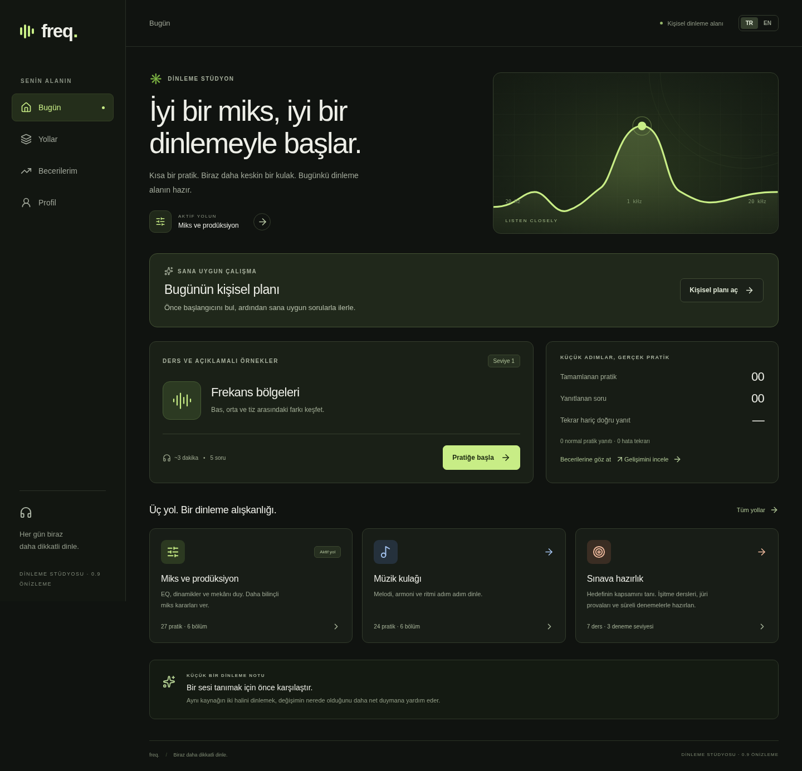
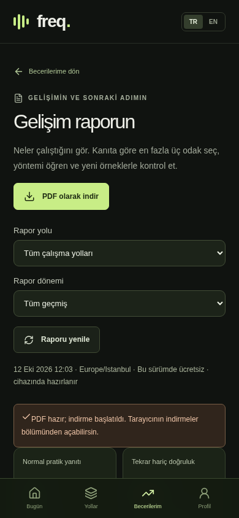

# Belge hakkında

Bu doküman, **Freq 0.9 önizleme (`0.9.0-preview.1`)** sürümünün bütün özelliklerini ve kullanım akışlarını bir araya getirir. Uygulamanın amacı, ekranları, dersleri, ses araçları, kişiye uygun çalışma, sınav hazırlığı, gelişim raporu, PDF indirme, kaynak önerileri ve kayıt yönetimi açıklanır. Son bölümde teknik yapı, doğrulama durumu ve geliştirme hedefleri bulunur.

**İncelenen uygulama kodu:** `aa2f1bce63682f3edadad638ed7263eccec008d0`. **Belge tarihi:** 12 Ekim 2026, Europe/Istanbul. Bu, belirtilen sürümün durumunu anlatır; sonraki eklemeler için doküman güncellenmelidir. Ders ve kaynak katalogları doğrudan bu sürümün içerik tanımlarından alınmıştır.

| Mevcut kapsam | Sayı / durum |
| --- | --- |
| Ana öğrenme yolu | Miks ve prodüksiyon, Müzik kulağı, Sınava hazırlık |
| Kısa otomatik pratik | 54: miks 27, müzik 24, melodik hafıza 3 |
| Beceri | 20 |
| Sınav hazırlık modülü | 7 aile × 3 seviye; öğretim ve prova alanı |
| Sınav hazırlık profili | 3: ortak hazırlık ve iki MSGSÜ programı |
| Miks ses kaynağı | 5: üç sentez, iki gerçek kayıt düzenlemesi |
| Eğitim kaynağı | 12: 11 ücretsiz, bir isteğe bağlı ücretli kitap |
| Dil | Türkçe ve İngilizce |
| Kullanım biçimi | Web ve ana ekrana kurulabilen PWA |
| Kayıt ve rapor | Cihazda ilerleme, JSON yedek, PDF gelişim raporu |
| Ücret / hesap | Bu önizlemede ödeme ve üyelik hesabı yok |

54 pratik sayısı **benzersiz kısa dersleri** ifade eder. Sınav modüllerinin üç seviyesi, mevcut pratiklere de yönlendirebilen ayrı bir öğretim alanıdır; bunları 54'e ekleyip 75 farklı otomatik pratik varmış gibi saymak doğru olmaz. Sınavın kişisel çalışma yolunda müzik yolunun bazı becerileri de kullanılır.

# 1. Freq'in amacı ve hedef kitlesi

Freq, öncelikle miks ve prodüksiyon yapan kişinin ses farklarını daha bilinçli dinlemesine yardımcı olan bir kulak pratiği uygulamasıdır. EQ, ses yüksekliği, dinamikler, stereo ve mekân etkileri odak noktasındadır. Temel müzik işitmesi ve konservatuvar/müzik bölümüne hazırlık, kendi öğrenme yollarında yer alır.

Eğitim yaklaşımı **açıklama → yanıtı görünen örnek → bağımsız pratik → geri bildirim → yeniden çalışma** akışını izler. Kullanıcıya yalnızca doğru/yanlış sonucu vermek yerine hedef ile kendi seçiminin nasıl duyulduğunu karşılaştırma olanağı sunar. Aşamalar, dinlenecek farkı küçük parçalara böler.

| Kullanıcı | Kullanabileceği başlıca alanlar |
| --- | --- |
| Miks öğrenen veya prodüksiyon yapan kişi | EQ, kompresyon, attack/release, masking, stereo, reverb/delay ve kendi kayıt laboratuvarı |
| Müzisyen veya temel işitmesini geliştiren kişi | Ses yönü, aralık, akor, tonal merkez, derece, işlev, dikte ve ritim |
| Konservatuvar / müzik bölümü adayı | Kurum kapsam haritaları, ses/ezgi/ritim provaları, solfej örnekleri ve süreli işitme denemeleri |
| Öğretmenle çalışan kişi | Kendi sonuçlarını gözden geçirme, PDF raporunu kendi seçimiyle paylaşma, söyleme/icra provası |

Freq genel müzikal yeteneği, klinik işitmeyi veya sınava kabul olasılığını ölçen standartlaştırılmış bir test sunmaz. Sonuçlar uygulamada yapılan görevlerin kayıtlarıdır. Söyleme ve çalgı icrası için öğretmen geri bildirimi önemini korur.

# 2. Ana ekranlar ve gezinme

Uygulamanın dört ana gezinme öğesi **Bugün, Yollar, Becerilerim ve Profil**'dir. Geniş ekranda yan menü, telefonda alt gezinme kullanılır. TR/EN anahtarıyla dil değiştirilebilir.

| Ekran | İçerik ve işlemler |
| --- | --- |
| Bugün | Aktif yol, kişisel plan kartı, önerilen ders veya yarım pratik, çalışma özeti, yakın sonuçlar, yol kısayolları ve gelişim raporu bağlantısı |
| Yollar | Üç öğrenme yolunun açıklamaları, bölüm/pratik sayıları ve yol ayrıntısına geçiş |
| Yol ayrıntısı | Açılır ders grupları, doğrudan seçilebilen dersler, aktif yol seçimi; miks laboratuvarı veya sınav atölyesi gibi ilgili alanlar |
| Becerilerim | 20 beceri kartı, önerilen aşama, tekrar hariç son 20 yanıt doğruluğu, hata tekrarı sayısı, çalışma kılavuzu, gelişim raporu ve yakın müzik yanıtlarını yeniden dinleme |
| Profil | Dil ve varsayılan yol tercihi, kulaklık/ses denemesi, kayıt kredileri, PWA bilgisi, JSON yedek indirme/geri yükleme ve geçmişi silme |

Pratik, ders sonucu, kişisel çalışma, laboratuvar ve gelişim raporu ilgili ana ekrandan açılan çalışma alanlarıdır. Örneğin gelişim raporunda Becerilerim menüsü seçili görünür. Böylece ana gezinmeye yeni bir kalabalık eklenmez.

{width=100%}

# 3. Bir ders ve pratik nasıl çalışır?

## 3.1 Ders akışı

1. Bugün'deki öneriyi veya Yollar'dan bir dersi aç.
2. Konunun açıklamasını, neye dikkat ederek dinleyeceğini ve ipucunu oku.
3. Miks derslerinde kullanılacak ses kaynağını seç. Gereken görevlerde stereo kontrolünü yap.
4. Yanıtı görünen örneği dinle. İleri miks konularında etiketli ayarları sırayla seçip farkları öğrenebilirsin.
5. Hazır olduğunda beş soruluk bağımsız pratiği başlat.
6. Sorunun dinleme koşulunu tamamla ve yanıt ver.
7. Doğru hedefi, açıklamayı ve varsa kendi seçiminin sesini/konumlarını karşılaştır.
8. Beşinci yanıtın ardından sonuç ekranını incele; aynı dersi, önerilen çalışmayı veya gelişim raporunu aç.

Dersler doğrudan seçilebilir; uygulama kullanıcıyı zorunlu bir ders zincirine kilitlemez. Mevcut yarım dersin yerine farklı bir derse geçerken açık seçim istenir. Kabul edilmiş cevaplar geçmişte kalır. Aynı dersi yeniden açmak yarım oturuma dönmeyi sağlar.

## 3.2 Dinleme ve yanıtın açılması

Dinleme alanında oynat/durdur, ses seviyesi ve göreve uygun A/B araçları bulunur. Miks döngülerinde A ve B'nin her birinde en az **bir saniye gerçek ses saati** ilerlemesi gerekir. Düğmelere hızla basmak bu koşulu karşılamaz. Durdurma, tamamlanmamış dinleme süresini sıfırlar.

Melodik hafıza ve ritim karşılaştırması gibi sonlu örneklerde gereken sesler tamamlanmalıdır. Tek örnekli müzik görevinde de sorulan örnek sonuna kadar dinlenir. Tonal bağlamı veya aday sesi tek başına dinlemek, sorunun asıl dinleme koşulunu tamamlamaz. Tekrar dinleme ve geri bildirim sesleri yeni puan oluşturmaz.

## 3.3 Geri bildirim ve yeniden dinleme

| Görev | Yanıt sonrası açıklama |
| --- | --- |
| EQ | Doğru frekans, EQ eğrisi ve yanlış seçimde o frekansın C örneği |
| Ses yüksekliği | A'ya göre B'nin göreli dB farkı |
| İleri miks | A/B ve varsa C ayarları, dinlenen gerçek sesin tepe zarfı, crest factor; stereo görevinde korelasyon |
| Ritim ayırt etme | A ve B'nin vuruş/boşluk haritaları ve değişen konumlar |
| Tonal görevler | Majör tonal referans, doğru derece/işlev ve seçilen cevap; uygun görevde tonik'e dönüş örneği |
| Melodik dikte | Hedef ile yazılan derecenin konum konum karşılaştırması |
| Ritmik dikte | Hedef ve yazılan ritim ızgaraları |
| Ritim tekrarı | Vuruş sayısı, dengelenen ofset, ortalama sapma ve eşleşen vuruşların zaman farkları |

Bağımsız soruda yanıtı açığa çıkaracak ayar veya hedef çizimi gizlidir. Açıklamalı öğrenme örneğinde bunlar görülebilir. Görselleri incelemek kadar sesi yeniden karşılaştırmak da öğrenme akışının parçasıdır.

# 4. Miks ve prodüksiyon yolu

Bu yol **9 beceri ve 27 pratik** içerir. Altı açılır bölüm vardır: EQ ve frekans, ses yüksekliği, dinamikler, masking ve ayrışma, stereo alan, reverb ve delay. Bütün derslerin tam listesi Ek A'dadır.

| Beceri | 1. aşama | 2. aşama | 3. aşama |
| --- | --- | --- | --- |
| EQ | Bas/orta/tiz bölgeleri | 100 Hz, 300 Hz, 1 kHz, 3 kHz, 7 kHz referansları | Daha dar bantta yükseltme/kesme |
| Ses yüksekliği | ±6 dB veya aynı | ±3 dB veya aynı | ±1 dB veya aynı |
| Kompresyon | Kompresyonun dinamik etkisi | 2:1, 4:1, 8:1 oranları | Miks içinde 4:1 referansa göre fark |
| Attack / atak | İlk vuruşun kenarı | Atak ile gövde ilişkisi | Daha ince atak farkları |
| Release / bırakma | Seviye geri dönüşü | Vuruşlar arasındaki toparlanma | Daha ince bırakma farkları |
| Masking / örtüşme | Hedef melodiye yer açma | Örtüşen frekans bölgeleri | Küçük eşlik kesmelerini miks içinde duyma |
| Stereo | Sol/orta/sağ konumu | Genişlik ve yan bileşen | Polarite örneğiyle mono uyumluluğu |
| Reverb | Efekt miktarı | Nominal kuyruk süresi | Ön gecikme |
| Delay | Tekrar aralığı | Feedback / sönme | Merkez ile ping-pong |

## 4.1 A, B ve C'nin anlamı

EQ'da A orijinal, B hedef EQ uygulanmış örnektir. Yanlış frekans seçilirse C, kullanıcının seçtiği frekansa hedefle aynı gain/Q uygulanmış hâlidir. İleri miks görevlerinde A referans, B sorulan ayar, yanlış yanıt sonrasında C seçilen ayardır. A'nın bazı ileri aşamalarda zaten işlenmiş bir referans olabileceği dersin açıklamasında belirtilir.

A/B/C, aynı zaman çizgisinde karşılaştırılır. EQ ve ileri miks seslerinde ortalama seviyeler eşitlenir; böylece daha yüksek örneği otomatik olarak daha farklı veya daha iyi sanma etkisi azaltılır. Ses yüksekliği derslerinde ise amaç dB farkını duymaktır; fark özellikle korunur. Sinyal seviyesini eşitlemek her kaynakta algısal yüksekliği kusursuz eşitleme garantisi değildir.

## 4.2 Beş ses kaynağı

| Kaynak | İçerik |
| --- | --- |
| Elektronik groove | Sentez davul, bas ve arpej dengesi |
| Ritim ağırlıklı | Sentez vuruşlar, gövde ve hi-hat dokusu |
| Arpej ağırlıklı | Sentez nota katmanları, bas ve parlaklık |
| Akustik piyano | Gerçek piyano ve vurmalı kayıtlarından hazırlanmış CC0 düzenleme |
| Kaydedilmiş vurmalılar | Gerçek kick, trampet ve claves kayıtlarından CC0 düzenleme |

Kaynak beş soruluk tur boyunca korunur ve kayıt/yedek ayrıntısına dahil edilir. Gerçek kayıtlar VSCO 2 Community Edition'dan gelir; kısa eğitim düzenlemeleridir. Bunlar tam ticari şarkı veya kapsamlı grup multitrack arşivi değildir. Piyano ve vurmalı katkılarının kredileri Profil'de, kaynak ve uyarlama kayıtları depoda bulunur.

## 4.3 Stereo ve masking araçları

Stereo dersleri ile ping-pong delay aşamasında sol/sağ örnekleri ve kullanıcı doğrulaması bulunur. Sol ses sol, sağ ses sağ kulakta duyulmalıdır. Cihazdaki mono ses ayarı kontrol edilmelidir. Onay verilmeden ilgili pratiğin gerekli aşaması açılamaz.

İleri miks dinleme alanında Stereo/Mono seçimi vardır. Masking görevinde **Melodiyi tek dinle** hedef katmanı solo dinletir; ardından aynı hedef miksin içinde değerlendirilir. Solo dinlemek A ve B'nin ikisini dinlemiş sayılmaz. Masking örneğinde EQ yalnız eşlik katmanına uygulanır; hedef melodi korunur.

İleri dersler tek bir ayarı değiştirerek farkı öğretir. Kompresör, reverb ve delay eğitim motorlarının sayıları bütün ticari eklentilerde aynı davranışı garanti etmez. Eğitim ayarları her miks için hazır reçete olarak sunulmaz.

# 5. Miks laboratuvarı: kendi kaydında dene

**Yollar → Miks ve prodüksiyon → Laboratuvarı aç** üzerinden erişilir. Hazır kaynaklarla veya kullanıcının seçtiği mono/stereo dosyayla serbest A/B denemesi yapılır. Laboratuvar puansızdır; otomatik miks kalitesi değerlendirmesi üretmez.

## 5.1 İşlemler ve kontrol aralıkları

| İşlem | Kullanıcının değiştirebildiği ayarlar |
| --- | --- |
| Kompresyon | Eşik −40…−6 dB; oran 1:1…10:1; atak 1…80 ms; bırakma 20…800 ms |
| Masking / eşlik EQ | Eşlik frekansı 250…3500 Hz; kesme −15…0 dB |
| Pan | −1 sol, 0 orta, +1 sağ |
| Genişlik | Yan bileşen 0…2 kat |
| Polarite | Sağ kanal polaritesini ters çevirme kutusu |
| Reverb | Nominal kuyruk 0,3…3 s; ön gecikme 0…100 ms; efekt miktarı 0…0,7 |
| Delay | Aralık 80…600 ms; feedback 0…0,7; efekt miktarı 0…0,7; ping-pong seçimi |

İşlemler ayrı ayrı seçilip çalışılır; bu alan bütün efektleri aynı anda zincire dizen bir DAW değildir. A ilgili referansı, B kullanıcının ayarını çalar. Stereo/mono, uygun işlemde solo ve sinyal ölçümleri kullanılabilir.

## 5.2 Dosya seçme ve WAV indirme

Dosya boyutu en fazla **20 MiB** olabilir. Dosya en az 0,25 saniye, en fazla iki kanallı olmalıdır. İlk **sekiz saniye** işlenir; reverb/delay için kuyruk alanı eklenir. WAV önerilir; MP3, FLAC, M4A veya OGG gibi biçimler tarayıcının çözme desteğine bağlıdır.

Kullanıcının kendi kaydıyla masking çalışması için ayrı hedef ve eşlik dosyası gerekir. İki dosya aynı zaman noktasından başlamalıdır. Yalnız bütün miks dosyasını seçmek, içindeki enstrümanları otomatik olarak ayırmaz. Mono dosyada mevcut stereo side bileşeni bulunmadığı açıklanır.

**İşlenmiş örneği indir** stereo PCM16 WAV üretir. Bu, çalışma önizlemesidir; bütün şarkının mastering çıktısı değildir. Ses dosyaları cihazda işlenir, sunucuya yüklenmez ve ilerleme yedeğine eklenmez. Laboratuvardan çıkınca veya sayfayı yenileyince dosya yeniden seçilmelidir. Dosya okuma başarısız olduğunda mevcut geçerli kaynak korunur.

# 6. Müzik kulağı yolu

Müzik yolu **24 pratik** içerir. Melodi ve armoni, ritim, tonal merkez ve dereceler, işlevsel işitme, dikte atölyesi ve ritim tekrarı bölümlerine ayrılır.

## 6.1 Temel ses yönü, aralık ve akor

Ses yönünde yukarı/aşağı hareket; aralıkta sesler arasındaki mesafe; akorda majör/minör niteliği ayırt edilir. Bu üç becerinin mevcut sürümde **birer pratik aşaması** vardır. Eski içerik etiketleri sırasıyla 1, 2 ve 3 olsa da her birinde üç ayrı seviye bulunmaz; kişisel model hayalî ek seviyeler önermez.

Ritim ayırt etme üç aşamalıdır. 100 BPM'de dört sayım ve bir ölçü A/B kalıbı duyulur. Tempo, ses rengi ve vuruş sayısı sabittir. B aynı olabilir veya bir vuruş bir alt bölüme kayabilir. Sırasıyla sekizlik bölünme, sus/ters vuruş ve onaltılık hareket çalışılır.

## 6.2 Tonal merkez, derece ve işlev

| Beceri | Çalışılan içerik |
| --- | --- |
| Tonal merkez | Kadans ve melodi ardından adaylardan tonik seçme; son nota tonik varsayımını aşma; farklı tonlarda aynı merkezi duyma |
| Dizi dereceleri | Önce 1/3/5, sonra 1–5, ardından majör dizinin yedi derecesi |
| İşlevsel işitme | Tonik, hazırlık ve dominant; çevrimlerle rolün korunması; V–I, IV–I ve V–vi dönüşleri |

Tonal görevlerde I–IV–V7–I kadansı majör bağlamı kurar. “1” sabit Do veya başka bir mutlak nota değil, o tonalitenin merkezidir. Tonal bağlam tekrar dinlenebilir. Tonik görevinde aday sesler ayrı dinletilir; uygun derece geri bildiriminde tonik'e dönüş örneği sunulur.

Mevcut tonal içerik majördür. Minör/kromatik işitme ve makam/usul hazır görev olarak bulunmaz. Majör/minör akor ayırt etme pratiğinin bulunması, minör tonal bağlamdaki derece eğitimini tamamlamış olmak anlamına gelmez.

## 6.3 Melodik ve ritmik dikte

Melodik diktede kısa tek sesli melodinin göreli dereceleri kutulara girilir. Aşamalar üç ses, dört ses ve altı adım/sus görevleridir. Kullanıcı kutu seçer, derece girer ve yanlış konumu düzenler. Son aşamada sus seçilebilir. Normal pratikte taslak dinlenebilir; **Yanıtı gönder** ile kayıt oluşur.

Ritmik diktede 4/4 bir ölçü vuruş/boşluk ızgarasına yazılır. İlk aşama dörtlük, ikinci sekizlik, üçüncü onaltılık konumları kullanır. Hücrelere basmak ses/boşluk durumunu değiştirir. Normal pratikte yazılan kalıp dinlenip temizlenebilir.

Bu girişler kısa ve eşit bölümlüdür. Tam porte, nota süreleri, bağlar, anahtar/donanım ve uzun eser transkripsiyonu bu sürümdeki dikte kapsamından geniştir. Gönderilen yanıt kalıcı kayda girer; gönderilmemiş taslak alandan çıkınca temizlenir. Başlangıç değerlendirmesinde ve süreli denemede yanıtı açabilecek taslak önizlemesi kapalıdır.

## 6.4 Ritim tekrarı

Kullanıcı önce örneği tamamlar. Tekrar akışı **dört sayım → örnek → dört hazırlık sayımı → kullanıcının ölçüsü** şeklindedir. Kayıt alanında ekrana dokunma veya Space ile vuruş yapılır. Mikrofon kullanılmaz. Kullanıcı kaydı inceleyebilir, yeniden deneyebilir ve açıkça gönderebilir; gönderilmemiş deneme puan oluşturmaz.

| Aşama | Tempo / alt bölüm | Her vuruş için yerel tolerans |
| --- | --- | --- |
| 1 | 90 BPM / dörtlük | ±100 ms |
| 2 | 90 BPM / sekizlik | ±80 ms |
| 3 | 100 BPM / onaltılık | ±65 ms |

Vuruş sayısı eşleşmeli; sabit ofset dengelendikten sonra her vuruş tolerans içinde olmalıdır. Sabit fark en fazla ±250 ms dengelenir. Eksik/fazla vuruş veya tempo sürüklenmesi bu dengelemeyle yok edilmez. Ofset bir cihaz gecikmesi ölçümü değildir. Ekranın veya Bluetooth bağlantısının zamanlama etkisini fiziksel cihazda ayrıca değerlendirmek gerekir.

## 6.5 Yakın yanıtları yeniden çalışma

Becerilerim ekranında yeniden kurulabilir en son beş yeni müzik becerisi yanıtı açılabilir. Doğru hedef, seçilen yanıt ve görev geri bildirimi yeniden dinlenir. Bu işlem puanı değiştirmez. Görünen son beş kayıt sınırı, geçmişin yalnız beş cevap sakladığı anlamına gelmez.

# 7. Sınava hazırlık atölyesi

**Yollar → Sınava hazırlık** ekranında üç sekme bulunur: **Kurum ve kapsam, Hazırlık dersleri, Denemeler**. Üç melodik hafıza kısa pratiği de bu yolun mevcut ders kataloğundadır: 3, 4 ve 5 notalı A/B hafıza karşılaştırmaları.

## 7.1 Profiller ve resmî kaynak kapsamı

| Profil | Mevcut kapsam |
| --- | --- |
| Ortak hazırlık | Tek/çok ses, ezgi, ritim, dikte, solfej ve icra için genel çalışma; bir kurumun resmî sınav şablonu değildir |
| MSGSÜ · Opera | 2026–2027 lisans kılavuzu, s. 25–26: duyuş, ses yeteneği/repertuvar ve kesin kabul aşamalarının kapsam haritası |
| MSGSÜ · Müzik teorisi | 2026–2027 lisans kılavuzu, s. 17–19: yazılı teori/analiz, sözlü duyuş/piyano/mülakat ve yazılı düzey sınavı kapsam haritası |

Profil; yıl, program, açıklama, kapsam maddeleri, ilgili derslere geçiş, resmî belge bağlantısı ve kontrol tarihi gösterir. Seçilen profile uygun hazırlık modülleri sunulur. Resmî belgeye dayanan **bir kurumun iki programı** doğrulanmıştır; bütün Türkiye'deki kurumların paketleri hazır değildir.

Opera kapsamı çok ses ve ritim duyuşuyla birlikte şan, hazırlanmış eserler ve jüri görevlerini içerir. Müzik teorisi kapsamı tam dikte, analiz, modülasyon, piyano ve görüşme gibi görevleri de içerir. Freq bu alanların mevcut otomatik görevlerle ne kadar karşılandığını açıklar. Kurumun güncel başvuru şartları, kontenjanı ve repertuvarı her başvuru döneminde resmî duyurudan kontrol edilmelidir.

## 7.2 Yedi modül ve üçer seviye

| Modül | Öğrenme / prova |
| --- | --- |
| Tek ses ve aralık tekrarı | Tek sesi tutma, iki sesi yön ve aralıklarıyla geri söyleme |
| İki, üç ve dört ses | Eşzamanlı sesleri pes–tiz sırasıyla ve iç sesleri koruyarak söyleme |
| Ezgi hafızası ve tekrar | Dört, altı, sekiz notalı prova; kısa otomatik hafıza/dikte derslerine destek bağlantıları |
| Ritim hafızası ve tekrar | Dörtlük, sekizlik ve onaltılık kalıpları tempo/suslarla tekrar |
| Melodik ve ritmik dikte | Kısa görevden ayrıntılı göreve ilerleme; tam kâğıt notasyonuna ek çalışma |
| Deşifre ve solfej | Sol anahtarı, Do majör, 4/4; bir veya iki ölçülük örnekleri nota adlarıyla okuma |
| Eser ve jüri provası | Kesintisiz sunum, tempo/cümleleme ve hedef repertuvar koşullarını gözden geçirme |

Her modülde açıklama, üç çalışma adımı, seviye odağı, uygun ses/notasyon örneği veya icra yönergesi, üç öz değerlendirme kutusu, çalışma notu ve ilgili kısa pratiğe geçiş vardır. Söyleme/çalgı icrası mikrofonla analiz edilmez. Öz değerlendirme kullanıcının gözlemidir; otomatik doğru/yanlış işitme puanıyla birleştirilmez. Tam seviye hedefleri Ek B'dedir.

## 7.3 Süreli denemeler

Her mevcut profilin Freq işitme uyarlaması üç aşamalıdır: **6 soru / 6 dakika, 8 soru / 8 dakika, 10 soru / 10 dakika**. Bu toplam süreler soru başına ayrı sayaç anlamına gelmez; denemenin tek son teslim zamanı vardır. Soru başına en fazla üç dinleme hakkı bulunur.

Başlangıçta hazırlık/onay adımı vardır; **Süreyi başlat** ile sayaç başlar. Sorunun gerekli dinlemesi tamamlanmadan yanıt açılamaz. Deneme bitene kadar doğrular gizlidir. Boş bırakma ve erken bitirme mümkündür. Sesin başlatılamaması durumunda harcanan dinleme hakkı geri verilir; başlamış fakat yarıda kesilen dinleme tamamlanmış sayılmaz.

Süre sekmeden çıkınca veya sayfa kapanınca işlemeye devam eder. Yeniden açıldığında ilk son teslim zamanı korunur; süre dolduysa kalan sorular boş sonuçlanır. Denemeyi yedekten geri almak süreyi yeniden başlatmaz. İstenilen anın taslak girdisi yerine kabul edilmiş yanıtlar saklanır.

Sonuç ekranında doğru/yanlış/boş sayıları, her sorunun yeniden dinlenmesi, derece/ritim geri bildirimi ve çalışılacak beceriye geçiş bulunur. Deneme yüzdesinde boş sorular toplam soru sayısında kalır. Normal kişisel pratikte ise geçilen sorular pratik doğruluğuna dahil edilmez. Ekrandaki son denemeler listesi en son 30 sonucu gösterebilir; daha eski kaynak geçmişi sayıya bağlı olarak silinmez.

Bu denemelerin süre, soru sayısı ve dinleme kuralları Freq çalışma ayarlarıdır. Tam resmî sınav simülasyonu, şan/çalgı jüri puanı veya kabul puanı hesaplanmaz.

# 8. Kişiye uygun çalışma

**Bugün → Kişisel planı aç** üzerinden erişilir. Kullanıcı Miks, Müzik kulağı veya Sınava hazırlık yolunu seçebilir. Alan; başlangıç değerlendirmesi, günlük öneri, kişisel pratik, yanlışlardan tekrar, beceri aşamalarının gerekçeleri ve yakın kişisel sonuçları bir araya getirir.

## 8.1 Başlangıç değerlendirmesi

| Yol | Ölçülebilir beceri | Soru |
| --- | --- | --- |
| Miks | 9 | 18 |
| Müzik kulağı | 10 | 20 |
| Sınava hazırlık | 6 | 12 |

Her beceride iki başlangıç sorusu vardır. İlk yanıt doğruysa ikinci soru, mevcutsa bir sonraki aşamadan gelir; tek aşamalı beceride aynı aşamadan yeni soru kullanılır. Süre sınırı yoktur. Kullanıcı bilmediği soruyu geçebilir, kaydedip ara verebilir veya değerlendirmeyi açık seçimle sonlandırabilir.

Tamamlanan değerlendirme geçici bir çalışma önerisi sağlar. Tamamen geçilen beceri ve tamamlanmamış yeniden değerlendirme, mevcut başlangıç önerisini kendiliğinden değiştirmez. Sonuçlar değerlendirme bitince gösterilir. İki soru kalibre edilmiş yetenek ölçümü sayılmaz; başlangıç önerisi yeni pratikle netleşir. Değerlendirme yanıtları normal pratik yüzdesine eklenmez.

## 8.2 Aşama önerisi nasıl değişir?

| Durum | Mevcut ürün kuralı |
| --- | --- |
| Daha ileri aşamayı önerme | Son 10 farklı yeni soruda en az iki oturum; iki seçenekli görevde en az 9 doğru ve iki farklı duyulan örnek, diğerlerinde en az 8 doğru ve üç farklı duyulan örnek |
| Daha rahat aşamayı önerme | En az iki oturumdaki son altı yeni sorunun en fazla ikisi doğruysa, mevcut aşama elverdiğinde bir basamak aşağı |
| İlk aşamada belirgin zorlanma | Hayalî daha düşük aşama üretmek yerine açıklamalı örnek ve destekli çalışma önerisi |
| Elle daha ileri dersi çalışmak | O aşamadaki sürdürülen başarı ve çeşitlilik mevcut öneriye yansıyabilir |
| Eski ses ayrıntısı eksik kayıt | Geçmiş sayımında korunur; yeni/farklı ses kanıtı uydurulmaz |
| Aynı sorunun veya hata tekrarının yeniden çözümü | Tek başına ileri aşama kanıtı oluşturmaz |

Rastgele soru kimliğinin değişmesi, mutlaka farklı ses duyulduğu anlamına gelmez. Model, yeniden kurulabilir soru ve duyulan örnek çeşitliliğini ayrıca dikkate alır. Aşama gerekçesi açılır ayrıntıda okunabilir. Bunlar Freq'in çalışma kurallarıdır; bilimsel olarak doğrulanmış ustalık ölçeği değildir.

## 8.3 Günlük kişisel pratik ve hata takvimi

Kişisel pratik beş soru içerir; en fazla iki zamanı gelmiş hata tekrarı, kalan bölüm yeni odak sorularıdır. Yeni içerik için zorlanma, veri eksikliği ve son çalışma zamanı değerlendirilir. Başka uygun alanlar varken en son çalışılan zayıf beceri bir sonraki odağı sürekli tekeline almaz.

Yanlış yanıtın özgün dersi, sesi ve kaynak ayrıntısı uygun olduğunda tekrar kartı oluşturur. Aynı ders/ses hataları tek kartta birleştirilir. İlk tekrar **10 dakika** sonradır. Zamanında doğru yanıtlarla sonraki aralıklar **1 gün, 3 gün, 7 gün** olur; dördüncü zamanında başarı kartı kapatır. Yanlış tekrar takvimi yeniden 10 dakika sonrasına alır. Erken doğru tekrar aralığı ilerletmez; boş yanıt takvimi değiştirmez.

**Yanlışlarımı çalış** ile tekrarlar erkenden de denenebilir. Hata tekrarları normal pratik yüzdesinden ayrı tutulur. Kişisel ve sıradan ders oturumları ayrı korunur; yarım kişisel çalışma kaydedilip daha sonra sürdürülebilir.

# 9. Beceri haritası, istatistikler ve gelişim raporu

## 9.1 Becerilerim kartları

20 beceri kartında önerilen aşama, normal pratikteki son 20 yanıtın doğruluğu, hata tekrarı sayısı ve ilgili pratiğe geçiş vardır. Henüz çalışılmamış beceride ölçülmemiş durum gösterilir; verisizlik otomatik %0 beceri olarak yorumlanmaz. **Nasıl çalışmalıyım?** ayrıntısı dinleme ipucu, üç adım, kısa oturum, gerçek bağlam, yeni örnekle kontrol ve ilgili kaynakları sunar. Ek C bütün kılavuzları içerir.

## 9.2 Raporu açma ve filtreler

**Becerilerim → Gelişim raporunu aç** ana girişidir. Bugün ve ders sonucu ekranlarında **Gelişimini incele** kısayolu da vardır. Raporun yolu Miks / Müzik / Sınava hazırlık / Tüm çalışma yolları; dönemi Tüm geçmiş / Son 30 gün / Son 7 gün olarak seçilebilir.

Rapor günleri **Europe/Istanbul** takvimine göre hesaplanır; bugün raporun hazırlandığı ana kadar kapsanır. **Raporu yenile** güncel görünümü oluşturur. Tarih filtresi yanıtlar ve karşılaştırmayı süzer. Bugünkü aşama ile bekleyen tekrarlar tüm geçerli geçmişi kullanır. Veri yeterliliği açıklaması seçili döneme göre değişebildiğinden odak sırası dönemle değişebilir; kayıtlı çalışma verisi değiştirilmez.

## 9.3 Raporun içerdiği bilgiler

- Normal pratik yanıtı/doğru sayısı ve tekrar hariç doğruluk.
- Tamamlanan ve kısmi/sonlandırılmış pratik oturumları.
- Yeniden kurulabilir farklı sorular, duyulan farklı örnekler ve ses ayrıntısı eksik eski yanıtlar.
- Son yedi **kayıtlı günün** normal pratik/hata tekrarı grafiği ve erişilebilir sayısal tablo.
- En fazla üç gerekçeli çalışma odağı, önerilen aşama, yeni soru/oturum hedefi ve zamanı gelen tekrarlar.
- Her odak için yöntem, kısa oturum, gerçek bağlamda uygulama, yeni örnekle kontrol ve kaynaklar.
- Esnek yedi günlük plan; ilgili ders, kişisel plan, laboratuvar veya sınav alanına geçiş.
- Hata tekrarı, başlangıç değerlendirmesi, süreli deneme ve icra öz değerlendirmesinin ayrı kayıtları.
- Beceri ayrıntısı, ilk veriden yeniden tahmin edilen aşama ve bugünkü öneri.
- Karşılaştırılabilir soru koşulları sağlanırsa yüzde puan değişimi; sağlanmıyorsa gerekçe.
- İlgili kitap başvuruları, veri yeterliliği ve yöntem/mahremiyet açıklaması.

Grafik çalışma miktarını gösterir; genel öğrenme yüzdesi değildir. Son yedi kayıtlı gün ile son yedi takvim günü her zaman aynı değildir. Çalışılmamış gün otomatik %0 başarı sayılmaz. İlk aşama bugünkü kurallarla ilk veriden yeniden tahmin edilir; o tarihte saklanmış bir seviye sınav notu değildir.

## 9.4 Karşılaştırma koşulları

Aynı becerinin aynı kayıtlı çalışma yolu, aynı ders aşaması ve aynı ses kaynağı karşılaştırılır. Son iki soru penceresi en çok onar farklı soru içerir. Her pencerede en az beş soru, en az iki oturum ve iki seçenekli görevlerde iki, diğer görevlerde üç farklı duyulan örnek gerekir. Tekrar yanıtları bağımsız yeni soru sayılmaz.

Örneğin %50 → %70, **+20 yüzde puan** değişimdir. Bu, bütün müzikal yeteneğin %40 arttığı iddiası değildir. Daha zor aşamaya geçince farklı aşamaların yüzdeleri doğrudan kıyaslanmaz. Küçük, eşleşmeyen veya eski eksik veride kesin gelişim/zayıflık hükmü verilmez.

# 10. İstenildiğinde PDF raporu indirme

Gelişim ekranında **PDF olarak indir** gerçek bir `.pdf` dosyası oluşturur. İndirme anındaki yol, dönem, dil ve tarih kullanılır. PDF, seçilebilir Türkçe/İngilizce metin, A4 sayfalar, sayfa numaraları ve tıklanabilir kaynaklar içerir.

PDF; çalışma özeti, öncelikler, teknikler, esnek plan, beceriler, ayrı değerlendirme kayıtları, yakın günlük hareketler, kaynaklar ve ölçüm sınırlarını kapsar. Ayrıntı listeleri günlük hareket için son 14 kayıtlı gün, denemeler için son beş sonuçla sınırlıdır; özet toplamları seçilen dönemin bütün geçerli kayıtlarından hesaplanır. Listelerin kısa tutulması kaynak geçmişini silmez.

Rapor cihazda hazırlanır; rapor için e-posta veya hesap istenmez. Dosya kişinin adı veya laboratuvar sesini içermez. Serbest icra notunun özel metni rapora kopyalanmaz; ilgili öz değerlendirme sayıları ayrı kalır. Öğretmenle paylaşmak isteyen kullanıcı dosyayı kendisi paylaşır; otomatik gönderim yoktur.

PDF hazırlanırken ilerleme/tekrar takvimi değiştirilmez. Üretim başarısız olursa hata ve yeniden deneme sunulur. Tarayıcı yeni veriyi saklayamıyorsa veya kurtarılabilir kayıt sorunu varsa raporun bu sekmedeki okunabilir verilere dayandığı uyarısı ekranda ve PDF'de bulunur. PDF, geri yüklenebilir JSON yedeğinin yerine geçmez.

{width=38%}

# 11. Kitap, ücretsiz eğitim ve çalışma kaynakları

Katalog 12 kaynaktır: **11 ücretsiz kaynak ve bir isteğe bağlı ücretli miks kitabı**. Kaynak, beceriyle eşleştirilir. Türkçe uygun kaynaklar önceliklidir; gerekli olduğunda İngilizce tamamlayıcılar kullanılır. Arayüzü İngilizceye çevirmek, varsayılan Türkçe kaynak önceliğini değiştirmez.

Kartta başlık, yazar, format, dil, ücret durumu, inceleme tarihi, neden uygun olduğu ve gerekli erişim/kapsam notu vardır. Odak başına en fazla iki ücretsiz seçenek ve uygun olduğunda bir isteğe bağlı ücretli kitap sunulur. Ücretsiz açık kitaplar da bu seçimde yer alabilir. Tam katalog Ek D'dedir.

Ücretsiz bir anlatımda ticari eklenti gösterilmesi, o eklentiyi satın almak zorunlu olduğu anlamına gelmez. Mike Senior kitabının kütüphane kayıt bağlantısı bibliyografik doğrulamadır; ücretsiz tam metin veya güncel satış fiyatı değildir. Kitapların tümü okunarak ve bütün videolar oynatılarak karşılaştırmalı eğitim deneyi yapılmamıştır. Doğrulanmamış video oynatımı, konuşma dili veya Türkçe altyazı kart notunda belirtilir.

Kaynak bağlantısı kullanıcının seçimiyle dış siteyi açar. Video/kitaplar PDF'ye kopyalanmaz. Kaynağı izlemek uygulamada otomatik doğru cevap oluşturmaz; öğrenilen ipucu yeni sesle uygulanmalıdır. Mevcut sıralamayı sponsor ödemesi veya komisyon belirlemez; affiliate parametresi yoktur.

# 12. Dil, web, mobil ve çevrimdışı kullanım

Uygulamanın açıklamaları, seçenekleri, geri bildirimleri, gezinmesi, kişisel önerileri ve raporu Türkçe/İngilizce sunulur. Dil değiştirmek kayıtlı cevapları veya yarım çalışmayı silmez. Dış kaynakların dili kartta ayrıca belirtilir; Türkçe tanıtım başlığı İngilizce kaynağın çevrilmiş olduğu anlamına gelmez.

Freq mevcut sürümde **PWA**'dır: web tarayıcısında çalışır ve uygun cihazda ana ekrana eklenerek bağımsız pencere görünümünde kullanılabilir. iPhone'da Safari → Paylaş → Ana Ekrana Ekle; Android'de Chrome → Uygulamayı yükle/Ana ekrana ekle seçenekleri kullanılır. App Store ve Google Play için native paketler henüz hazırlanmadı.

İlk çevrimiçi açılış ve uygulama önbelleğinin kurulumu tamamlandıktan sonra mevcut pratikler, kişisel çalışma, laboratuvarın hazır kaynakları, denemeler ve PDF raporu çevrimdışı çalışabilir. Dış eğitim siteleri internet isteyebilir. Ortak telefon denemesi için HTTPS yayını kullanılmalıdır.

Ses kullanıcı etkileşimiyle başlatılır. Ekran kilitlenince, uygulama görünmez olunca veya ilgili ses bağlamı askıya alınca ses durabilir; geri dönüşte kullanıcı yeniden başlatır. Süreli deneme sayacı bu duruştan bağımsızdır. Yeni yayın eski sekme açıkken bekleyebilir; tüm Freq pencerelerini kapatıp yeniden açmak yeni sürümün devreye girmesini sağlar.

# 13. İlerleme, yedek ve kayıtların korunması

## 13.1 Cihazda saklananlar

İlerleme tarayıcının yerel kayıt alanındadır. Dil/ses/yol tercihleri, ders cevap ve sonuçları, yarım ders/kişisel oturumlar, başlangıç değerlendirmeleri, hata tekrarları için soru referansları, süreli deneme ve icra öz değerlendirmeleri saklanır. Oturum sayısı artınca geçmiş kendiliğinden budanmaz; gerçek tarayıcı kotası sınırdır.

Hesap ve bulut senkronizasyonu yoktur. Farklı cihaz, tarayıcı veya origin ayrı kayıt alanına sahip olabilir. Aynı origin içindeki yayın alt klasörlerinin çevrimdışı önbellekleri ayrılır; ilerleme ise origin'in yerel kayıt alanını kullanır. Bir başka cihaza taşımak için JSON yedek kullanılmalıdır.

## 13.2 JSON yedek indirme ve geri yükleme

**Profil → İlerlemeyi indir** yedek dosyası oluşturur. **Yedekten geri yükle** seçilen dosyayı cihazda doğrular ve birleştirme öncesinde özet/onay gösterir. Dosya sunucuya gönderilmez.

- Aynı kayıt ikinci kez içe alındığında tekrar sayılmaz.
- Mevcut dil ve ses tercihleri korunur.
- Mevcut yarım oturum yoksa yedekteki uygun oturum alınabilir.
- Aynı oturumun tutarlı kopyalarında daha ileri durum kullanılabilir.
- İki farklı yarım oturum veya aynı kimlikte çelişen cevap varsa birleştirme durur.
- Bozuk, desteklenmeyen veya 16 MiB sınırını aşan dosya mevcut ilerlemeyi değiştirmez.
- 0.8'den itibaren yedek zarfı sürüm 2'dir; eski düz JSON ve sürüm 1 yedekler okunabilir. Yeni zarf 0.8 veya üstünde kullanılmalıdır.
- Süreli denemenin eski son teslim zamanı korunur; yedek yüklemek süreyi sıfırlamaz.

Laboratuvara seçilen ses dosyaları ve gönderilmemiş dikte/dokunma taslakları yedeğe girmez. Önceki sürümlerde zaten silinmiş/budanmış geçmiş yalnız bunu içeren eski bir yedek varsa geri getirilebilir.

## 13.3 Kayıt sorunu, kota ve birden çok sekme

Tarayıcı kayıt yapamazsa çalışma bellekte sürebilir; uyarıdan veya Profil'den yedek alınmalıdır. Bozuk orijinal kayıt kendiliğinden üzerine yazılarak sıfırlanmaz. **Bu sekmedeki veriyi indir** ve **Orijinal kaydı indir** ile okunabilir ve orijinal kopyalar ayrı korunabilir. Kurtarılmış kopyaya geçiş kullanıcı kararı ister; kurtarılamayan parçaların eksik olabileceği açıklanır.

Birden çok sekmenin uyumlu cevapları birleştirilebilir. Çelişen yarım çalışmalar veya cevaplar varsa otomatik yazma durur ve iki kopya indirilebilir. Eski kayıt alanından v2 alanına geçiş, eski açık uygulama sekmesinin yeni geçmişi budamasını önlemek için ayrıdır.

**Geçmişi sil** açık onay ister. Silmeden veya tarayıcı/site verilerini temizlemeden önce yedek alınmalıdır. PDF sonuç belgesidir; uygulama geçmişini geri yüklemez.

# 14. Kullanılabilirlik, klavye ve dinleme önerileri

| Araç / tuş | İşlev |
| --- | --- |
| Tab / Shift+Tab | Denetimler arasında klavye gezinmesi |
| Space | Uygun dinleme alanında oynat/durdur; ritim kayıt aşamasında vuruş |
| A / B | Uygun çiftli görevde karşılaştırma örneğini seçme |
| C | Yanlış seçimin karşılaştırması açıldıysa ilgili sesi seçme |
| Seçenek numaraları | Dinleme koşulu tamamlanmış seçmeli soruda yanıt verme |
| Melodik diktede sol/sağ ok | Yazılacak konumu değiştirme |
| Melodik diktede 1–7 | Görevin izin verdiği dereceyi yazma |
| Melodik diktede 0 | İzin verilen son aşamada sus girme |
| Escape | Açık modal karar penceresini kapatma |

Kısayollar bağlama göre çalışır. Metin/giriş alanında, açık modalde veya ritim yakalama sırasında genel dinleme kısayolları görevle çakışmayacak biçimde sınırlandırılır. Ekrandaki düğmeler de bütün temel işlemleri sunar.

Mobil ekranlar, açılır ayrıntılar, seçili öğeler, odak yönetimi, düğme adları, sayısal grafik tablosu ve renk dışında metin/işaret geri bildirimi kullanılabilirlik için düzenlenmiştir. Otomatik erişilebilirlik kontrolleri yapılmıştır; manuel VoiceOver/TalkBack ve bütün fiziksel cihaz matrisi tamamlanmış değildir. İndirilen rapor PDF'sinin metni seçilebilir; PDF/UA etiketli erişilebilirlik sertifikası yoktur.

Kulaklıkla rahat seviyede çalış. Bas ve stereo görevlerini küçük telefon hoparlöründen yorumlamak yanıltıcı olabilir. Stereo görevinden önce sol/sağ kontrolünü yap. Ritimde gecikme hissedersen kablolu kulaklıkla dene. Kısa oturumlar arasında mola ver; tek bir ayarı karşılaştırıp duyduğun farkı kendi sözlerinle tarif et. Uygulama mutlak kulaklık ses basıncını ölçmez.

# 15. İlk kullanım ve örnek çalışma rutinleri

## 15.1 İlk gün

1. Dili ve varsayılan öğrenme yolunu seç.
2. Kulaklığı/ses seviyesini dene; gerekli ise stereo kontrolünü tamamla.
3. Kişisel planda başlangıç değerlendirmesini yap veya doğrudan ilk açıklamalı dersi seç.
4. Bir beş soruluk kısa pratik tamamla ve yanlış seçimin sesini geri dinle.
5. Becerilerim'den ilgili kılavuzu aç; bir ipucu seç.
6. Gelişim raporunda verinin yeterliliğini ve sonraki öneriyi incele.
7. Profil'den JSON yedek indir. İstersen PDF raporunu ayrıca al.

## 15.2 Miks çalışması örneği

EQ'nun açıklamalı örneğini akustik piyano ile dinle; beş yeni soru çöz. Yanlış frekanslarda B/C farkını tarif et. Daha sonraki kısa oturumda başka bir kaynak kullan. Zamanı gelen hata tekrarını kişisel planda çalış. Laboratuvarda tek ayarı kendi kısa kaydına uygulayıp A/B karşılaştır. Yeni raporla aynı aşama ve kaynakta yeterli eşleşen veri oluşup oluşmadığını kontrol et.

## 15.3 Müzik kulağı çalışması örneği

Kadansla tonal merkezi kur; derece pratiğini tamamla. Kısa melodik diktede hatanın hangi konumda olduğunu incele. Ertesi oturumda yeni tonik/ezgi ile aynı ipucunu uygula. Bir ritim görevinde vuruş ve alt bölümü ayrı tut. Söyleme/çalma sonucunu öğretmenle değerlendir; uygulamanın ölçmediği icrayı otomatik doğru cevaba dönüştürme.

## 15.4 Sınav çalışması örneği

Hedef programın güncel resmî kılavuzunu kontrol et. Freq kapsam haritasında ilgili modülleri seç; tek/çok ses, ezgi ve ritim provalarını yap. Solfej/icra için öğretmene sunum hazırla. Süreli kısa deneme bittikten sonra yanlış/boş görevleri incele. Çalışma raporu ile uygulama içi işitme sonucunu takip et; gerçek kurum sınavının bütününü ayrıca prova et.

Bu rutinler uygulanabilir başlangıç örnekleridir. Belirli dakika veya tekrar sayısının her kişi için en iyi öğrenme süresi olduğu ya da sınav başarısı garanti ettiği iddia edilmez.

# 16. Kurulum, yayın ve teknik yapı

## 16.1 Kendi bilgisayarında çalıştırma

Node.js 24 LTS ile depoyu klonla veya kaynak ZIP'i aç. Proje klasöründe:

```sh
npm ci
npm run dev
```

Kendi bilgisayarındaki terminalin gösterdiği adresi o bilgisayarın tarayıcısında aç. Üretim çıktısını denemek için:

```sh
npm run build
npm run preview
```

Yayımlanabilir dosyalar `dist/` klasöründedir. Modüller, font doğrulama ve PWA için uygun HTTP/HTTPS sunumu gerekir; `index.html` dosyasını çift tıklayarak açmak standart kurulum değildir. Telefon ve ortak kullanım için HTTPS yayını tercih edilmelidir.

## 16.2 GitHub ile web yayınının farkı

GitHub kaynak kodunu ve dokümanları saklar. Web yayını GitHub Pages, Netlify veya Vercel gibi bir barındırma adımıdır. Pages için **Settings → Pages → Source: GitHub Actions**, ardından **Actions → Publish Freq to GitHub Pages → Run workflow** kullanılır. Yayın iş akışı elle başlatılır.

Netlify/Vercel için Node 24, kurulum `npm ci`, build `npm run build`, çıktı `dist` seçilir. Kullanıcı raporu için API anahtarı veya veritabanı gerekmez. Cloud geliştirme ortamını yayımlamak, çalışan web sitesini kendiliğinden yayımlamaz.

## 16.3 Teknik yapı ve lisanslar

| Katman | Kullanılan yapı |
| --- | --- |
| Arayüz | React, TypeScript, Vite; mobil duyarlı CSS ve Lucide simgeleri |
| Ses | Web Audio API; sentez, kayıt çözme, iki kanallı eğitim DSP'si, A/B zamanlaması ve PCM16 WAV üretimi |
| İçerik | Ayrı ders, ileri miks, müzik, sınav ve TR/EN içerik tanımları |
| Kişisel çalışma | Başlangıç, yeni soru kanıtı, aşama gerekçesi ve aralıklı tekrar modeli |
| Kayıt | Yerel tarayıcı alanı, doğrulanan JSON yedek ve kontrollü birleştirme/kurtarma |
| Rapor | Salt okunur rapor modeli; cihazda jsPDF 4.2.1 ile Unicode PDF |
| Çevrimdışı | Yayın kapsamına ayrılmış service worker önbelleği |
| Test | Vitest, Playwright, gerçek Web Audio ve PDF dosyaları, axe ve Poppler kontrolleri |

Rapor, kılavuz kaynakları ve PDF motoru ihtiyaç olduğunda yüklenir. Akustik kayıtların kaynak commit/hash/uyarlamaları ve CC0 lisansı saklanır. Raporda gömülü DejaVu Sans için font kaynağı ve lisans dosyası bulunur. Kaynak kitap ve videolar uygulamaya kopyalanmaz.

Ses motoru Web Audio'ya bağlıdır. Soru ve içerik katmanları native projelerde yeniden kullanılabilir; native ses, kayıt ve mağaza paketleri için ek uygulama gerekir. Mevcut uygulamada üretken yapay zekâ servisiyle kişisel tanı/rapor veya mikrofonla şan/çalgı analizi yoktur.

# 17. Doğrulama durumu ve mevcut sınırlar

12 Ekim 2026 tarihli 0.9 doğrulamasında **326 birim testi** ve **141 tarayıcı testi** geçti; TypeScript/üretim build'i tamamlandı. Tarayıcı turunda 115 kaynak/test/build dosyasının hash'i sabitliği doğrulandı. Gerçek ses zamanları, kayıt/dosya indirmeleri, Unicode PDF, yedekler, mobil görünüm, TR/EN ve kök/alt klasör çevrimdışı kullanım kontrol edildi. Bu belge hazırlığı, o testlerin yeni bir tekrar çalıştırılması değildir.

| Alan | Durum |
| --- | --- |
| Mevcut 54 pratik ve 0.9 rapor akışları | Otomatik yerel testleri geçti |
| Miks laboratuvarı, yerel dosya ve WAV | Otomatik akış/sinyal kontrolleri mevcut |
| Gerçek iPhone/Android, kablolu/Bluetooth | Fiziksel cihaz matrisi henüz tamamlanmadı |
| Manuel ekran okuyucu ve PDF/UA | Tamamlanmadı |
| Öğretmen/jüri ile içerik ve öğrenme pilotu | Tamamlanmadı |
| Başka ses/tınıda öğrenme aktarımı ve gecikmeli başarı | Deneysel pilot bekliyor |
| Bütün kurumların sınavları ve resmî ağırlıklarla puanlama | Hazır değil; mevcut kaynak haritası bir kurum/iki program |
| Ödeme, üyelik, sponsor ve affiliate | Etkin değil |
| Native mağaza uygulaması | Hazır değil |

Bu yerel test kayıtları uzak CI veya canlı sitenin son yayınının kanıtı değildir. Dar örnek havuzu, görev biçimi, cihaz/kulaklık ve eski kaydın ayrıntısı sonuçların yorumunu sınırlar. Açıklanan eşikler klinik işitme, mutlak müzik yeteneği veya kabul puanı kalibrasyonu sağlamaz.

# 18. Gelecek kapsam ve gelir modeli

| Alan | Planlanan geliştirme |
| --- | --- |
| İleri miks | Daha geniş lisanslı multitrack, birden çok sorunu birlikte teşhis, yeni kayıtta gerekçeli karar ve aktarım |
| Müzik kulağı | Minör/kromatik tonalite, ileri armoni, tam porte/süre girişi, daha uzun dikte |
| Makam/usul | Uzman ve icracı ortaklığıyla seyir, karar/güçlü, entonasyon ve usul; hazır ders yok |
| Sınav hazırlığı | Diğer kurumların program/yıl kılavuzları, daha geniş görevler ve öğretmen/jüri pilotu |
| Hesap ve platform | Güvenilir cihazlar arası kayıt/hak yönetimi ve native mağaza uygulamaları |
| Rapor | Pilotla anlaşılabilirlik, yeni dönem yorumu, istenirse ayrı belirtilen öğretmen desteği |

**Bugünkü raporlar ücretsizdir ve yeniden indirilebilir.** İleride ilk rapor ücretsiz, yeni dönem raporu ücretli veya sürekli yeni değer sağlayan üyelik seçenekleri değerlendirilebilir. Aynı raporu yeniden indirme ve başarısız üretim tekrarında hak tüketilmemelidir. Temel geçmişi görmek, hata açıklaması ve yedek almak korunmalıdır.

Gerçek ücretli hizmet için fiyat/kapsam, doğrulanmış ödeme, hesap, sunucu tarafında hak ve satın almayı geri yükleme/iptal akışları gerekir. Yerel tarayıcı sayacı güvenilir ücret hakkı sayılmaz. Sponsorlu eğitim/kitap tanıtımı ayrı ve görünür etiket taşımalı; çalışma odağı ve eğitsel kaynak sırası ödeme nedeniyle değişmemelidir. Mevcut sürümde reklam veya satış ortaklığı anlaşması etkin değildir.

# 19. Sık sorulan sorular

**Üyelik açmam gerekiyor mu?** Hayır. Mevcut uygulama yerel kayıtla çalışır.

**Bilgisayar ve telefonda geçmiş aynı mı?** Kendiliğinden eşitlenmez. JSON yedeğini diğer cihazda geri yükleyebilirsin.

**Kulaklık şart mı?** Stereo/ping-pong için sol/sağ ayrımı gerekir. Bas ve ince miks farkları için kulaklık uygun bir başlangıçtır; rahat seviyede kullanılmalıdır.

**Kendi şarkımı otomatik analiz eder mi?** Laboratuvar kısa dosyaya seçilen işlemi uygular ve A/B sunar. Otomatik sorun bulma, stem ayırma, miks kalitesi veya mastering puanı üretmez.

**Doğruluk düşerse geriledim mi?** Daha zor aşama, farklı kaynak ve az soru aynı yüzdeyi doğrudan karşılaştırmaya elverişli olmayabilir. Rapor eşleşen koşulu ve veri yeterliliğini açıklar.

**PDF'yi başka cihazda yükleyip devam edebilir miyim?** PDF sonuç belgesidir. Devam etmek için Profil'den alınan JSON yedek gerekir.

**Kitap satın almam gerekir mi?** Ücretli kitap isteğe bağlıdır; ücretsiz ilgili kaynaklar sunulur.

**Uçak modunda çalışır mı?** İlk çevrimiçi kurulum/önbellek tamamlandıktan sonra mevcut yerel özellikler çalışabilir. Dış eğitim siteleri ayrı internet erişimi isteyebilir.

**Uygulama sınavı kazanacağımı söyler mi?** Kabul tahmini veya gerçek jüri puanı hesaplamaz; kapsadığı işitme ve çalışma görevlerini destekler.

**İngilizceye geçince cevaplarım silinir mi?** Dil değişimi ilerlemeyi ve kabul edilmiş cevapları silmez.

**Verilerim silinirse?** Mevcut bir JSON yedeğin varsa geri yükleyebilirsin. Önceden yedeklenmemiş silinmiş geçmiş için bulut kopyası yoktur.

# 20. Terimler

| Terim | Bu uygulamadaki anlamı |
| --- | --- |
| A/B/C | Referans, hedef/değişmiş örnek ve uygun geri bildirimde kullanıcının seçimi |
| EQ / gain / Q | Frekans dengesi / bant seviye değişimi / bant genişliğiyle ilişkili kontrol |
| Attack / release | Kompresör azaltmasının uygulanma ve geri bırakılma hareketi |
| Masking | Kaynakların benzer frekans/bağlamda hedefin duyulmasını örtmesi |
| Pan / stereo width | Sol/sağ konum / merkez ile yan bileşen ilişkisine bağlı genişlik |
| Mono / polarite | Kanalların toplamını dinleme / kanal işaretinin ters çevrilmesi |
| Reverb / pre-delay | Yoğun yansıma kuyruğu / kuru sesle yankı başlangıcı arası bekleme |
| Delay / feedback / wet | Ayrı tekrarlar / tekrarların geri beslenmesi / eklenen efekt miktarı |
| Tonik / derece / işlev | Tonal merkez / o merkeze göre sesin yeri / akorun bağlamdaki rolü |
| Dikte / solfej | Duyulanı yazma / yazılan müziği nota adlarıyla okuma-söyleme |
| BPM / alt bölüm | Dakikadaki vuruş sayısı / vuruşun bölünmesi |
| Crest factor / korelasyon | Tepe ile ortalama ilişkisi / stereo kanalların benzerlik ilişkisi |
| Aşama önerisi | Mevcut içerikte uygun çalışma düzeyi; genel ustalık sertifikası değildir |
| PWA | Web uygulamasının ana ekrana kurulabilen, önbellekle çevrimdışı çalışabilen biçimi |
| JSON yedek / PDF rapor | Geri yüklenebilir uygulama kaydı / okunup paylaşılabilir sonuç belgesi |

# Ek A. 54 kısa pratiğin tam kataloğu

Bu liste uygulamanın gerçek ders tanımlarından alınmıştır. Aşama sütunu içeriğin saklanan etiketidir; ses yönü, aralık ve akor niteliğinde tek mevcut pratik olduğu ana metinde açıklanmıştır. Her satırın öğretici açıklaması ve örneği uygulamada bulunur.

## Miks ve prodüksiyon · 27 pratik

| Ders kimliği | Aşama | Ders adı | Çalışma hedefi |
| --- | --- | --- | --- |
| `eq-1` | 1 | Frekans bölgeleri | Bas, orta ve tiz arasındaki farkı keşfet. |
| `eq-2` | 2 | Frekans noktaları | Beş frekans noktasını sesleriyle tanı. |
| `eq-3` | 3 | Dar bantları duy | Daha küçük yükseltme ve kesmeleri ayırt et. |
| `loudness-1` | 1 | Belirgin seviye farkları | 6 dB farkla daha yüksek, daha düşük veya aynı seviyeyi ayırt et. |
| `loudness-2` | 2 | Küçük seviye farkları | 3 dB farkla daha yüksek, daha düşük veya aynı seviyeyi ayırt et. |
| `loudness-3` | 3 | 1 dB farkını dinle | 1 dB farkla daha yüksek, daha düşük veya aynı seviyeyi ayırt et. |
| `compression-1` | 1 | Kompresyonu duy | Ortalama seviyeleri eşit iki örnekte dinamik değişimi dinle. |
| `compression-2` | 2 | Oranı karşılaştır | Ortalama seviyeleri eşit iki örnekte dinamik değişimi dinle. |
| `compression-3` | 3 | Miks içinde dinamikler | Ortalama seviyeleri eşit iki örnekte dinamik değişimi dinle. |
| `attack-1` | 1 | İlk vuruşun kenarı | Kompresörün ilk vuruşa ne kadar hızlı tepki verdiğini duy. |
| `attack-2` | 2 | Atak ve gövde | Kompresörün ilk vuruşa ne kadar hızlı tepki verdiğini duy. |
| `attack-3` | 3 | İnce atak farkları | Kompresörün ilk vuruşa ne kadar hızlı tepki verdiğini duy. |
| `release-1` | 1 | Sesin geri dönüşü | Kompresörün vuruştan sonra sesi nasıl serbest bıraktığını dinle. |
| `release-2` | 2 | Vuruşlar arasındaki nefes | Kompresörün vuruştan sonra sesi nasıl serbest bıraktığını dinle. |
| `release-3` | 3 | İnce bırakma farkları | Kompresörün vuruştan sonra sesi nasıl serbest bıraktığını dinle. |
| `masking-1` | 1 | Melodiye yer aç | Hedef melodiyi tek başına tanı, ardından miks içinde karşılaştır. |
| `masking-2` | 2 | Örtüşen frekanslar | Hedef melodiyi tek başına tanı, ardından miks içinde karşılaştır. |
| `masking-3` | 3 | Küçük kesmeler, miks bağlamı | Hedef melodiyi tek başına tanı, ardından miks içinde karşılaştır. |
| `stereo-1` | 1 | Solda, ortada, sağda | Konum, genişlik ve mono toplamını ayrı ayrı keşfet. |
| `stereo-2` | 2 | Dar ve geniş | Konum, genişlik ve mono toplamını ayrı ayrı keşfet. |
| `stereo-3` | 3 | Mono uyumluluğu | Konum, genişlik ve mono toplamını ayrı ayrı keşfet. |
| `reverb-1` | 1 | Ne kadar reverb? | Miktar, kuyruk ve ön gecikmeyi birer birer ayırt et. |
| `reverb-2` | 2 | Kuyruğun süresi | Miktar, kuyruk ve ön gecikmeyi birer birer ayırt et. |
| `reverb-3` | 3 | Ön gecikmeyi duy | Miktar, kuyruk ve ön gecikmeyi birer birer ayırt et. |
| `delay-1` | 1 | Tekrarın zamanı | Tekrar aralığı, feedback ve stereo hareketi dinle. |
| `delay-2` | 2 | Tekrarlar nasıl söner? | Tekrar aralığı, feedback ve stereo hareketi dinle. |
| `delay-3` | 3 | Ping-pong ve merkez | Tekrar aralığı, feedback ve stereo hareketi dinle. |

## Müzik kulağı · 24 pratik

| Ders kimliği | Aşama | Ders adı | Çalışma hedefi |
| --- | --- | --- | --- |
| `direction-1` | 1 | Sesin yönü | İkinci ses yükseliyor mu, alçalıyor mu? |
| `interval-2` | 2 | Aralıkları tanı | İki ses arasındaki mesafeyi dinle. |
| `chord-3` | 3 | Majör ve minör | Akorun üçlüsündeki farkı keşfet. |
| `rhythm-1` | 1 | Vuruş ve bölünme | Aynı tempoda iki ritim kalıbını karşılaştır. |
| `rhythm-2` | 2 | Sus ve ters vuruş | Aynı tempoda iki ritim kalıbını karşılaştır. |
| `rhythm-3` | 3 | Onaltılık hareketler | Aynı tempoda iki ritim kalıbını karşılaştır. |
| `tonic-1` | 1 | Eve dönen sesi bul | Kadans ve melodiyi dinle; üç ses arasından tonal merkezi seç. |
| `tonic-2` | 2 | Son nota her zaman tonik değil | Kadans ve melodiyi dinle; üç ses arasından tonal merkezi seç. |
| `tonic-3` | 3 | Farklı tonlarda merkez | Kadans ve melodiyi dinle; üç ses arasından tonal merkezi seç. |
| `degree-1` | 1 | 1, 3 ve 5’i duy | Notanın majör tonalitedeki yerini, tonik referansıyla tanı. |
| `degree-2` | 2 | İlk beş derece | Notanın majör tonalitedeki yerini, tonik referansıyla tanı. |
| `degree-3` | 3 | Yedi derecenin rengi | Notanın majör tonalitedeki yerini, tonik referansıyla tanı. |
| `function-1` | 1 | Tonik, hazırlık, dominant | Akorları ses renginden öte, tonal bağlamdaki rolleriyle duy. |
| `function-2` | 2 | Çevrimlerin altında işlev | Akorları ses renginden öte, tonal bağlamdaki rolleriyle duy. |
| `function-3` | 3 | Armonik dönüşler | Akorları ses renginden öte, tonal bağlamdaki rolleriyle duy. |
| `melodic-dictation-1` | 1 | Üç sesi sıraya yaz | Kısa, tek sesli melodinin derecelerini adım adım yaz. |
| `melodic-dictation-2` | 2 | Dört derecelik melodi | Kısa, tek sesli melodinin derecelerini adım adım yaz. |
| `melodic-dictation-3` | 3 | Altı adım ve sus | Kısa, tek sesli melodinin derecelerini adım adım yaz. |
| `rhythmic-dictation-1` | 1 | Dörtlük vuruşları yaz | Dört sayımdan sonra duyduğun bir ölçüyü vuruş ve boşluk olarak yaz. |
| `rhythmic-dictation-2` | 2 | Sekizlik yerleşimler | Dört sayımdan sonra duyduğun bir ölçüyü vuruş ve boşluk olarak yaz. |
| `rhythmic-dictation-3` | 3 | Onaltılık ritim haritası | Dört sayımdan sonra duyduğun bir ölçüyü vuruş ve boşluk olarak yaz. |
| `rhythm-repeat-1` | 1 | Dört vuruşta tekrar | Dinlediğin bir ölçüyü ekrana dokunarak veya boşluk tuşuyla tekrar et. |
| `rhythm-repeat-2` | 2 | Sekizlik kalıbı çal | Dinlediğin bir ölçüyü ekrana dokunarak veya boşluk tuşuyla tekrar et. |
| `rhythm-repeat-3` | 3 | Onaltılıkta zamanlama | Dinlediğin bir ölçüyü ekrana dokunarak veya boşluk tuşuyla tekrar et. |

## Sınava hazırlık · 3 pratik

| Ders kimliği | Aşama | Ders adı | Çalışma hedefi |
| --- | --- | --- | --- |
| `memory-1` | 1 | 3 notalı hafıza | İki kısa melodi arasındaki değişimi yakala. |
| `memory-2` | 2 | 4 notalı hafıza | İki kısa melodi arasındaki değişimi yakala. |
| `memory-3` | 3 | 5 notalı hafıza | İki kısa melodi arasındaki değişimi yakala. |

# Ek B. Sınav modüllerinin 21 seviye hedefi

Bu modüller öğretim ve öz değerlendirme alanıdır. Mevcut kısa pratiklere geçiş sunarlar; aşağıdaki 21 satır ayrı 21 yeni otomatik test anlamına gelmez.

## Tek ses ve aralık tekrarı

Sesi rahat bir heceyle geri söyle. Ses aralığın dışındaysa oktavını değiştir; zorlamadan çalış.

| Seviye | Prova odağı |
| --- | --- |
| 1 | Tek sesi zihninde tut ve rahat heceyle geri söyle. |
| 2 | Yukarı çıkan iki sesi aralıklarını koruyarak tekrar et. |
| 3 | İnen, geniş ve küçük aralıkları ayrı ayrı tekrar et. |

**Çalışma adımları:**

1. Önce tek sesi dinle ve zihninde tut. Ses kesilince “na” ile söyle.
2. İki sesli örnekte ilk sesi sabitle, sonra aralığın yönünü ve mesafesini koru.
3. Kontrol için örneği yeniden dinle. Öğretmeninle entonasyonu değerlendir.

**Öz değerlendirme kutuları:** Başlangıç sesini korudum.; Sesler arasındaki mesafeyi korudum.; Sesimi zorlamadan tamamladım.

## İki, üç ve dört ses

Birlikte çalınan sesleri, pes sesten tize doğru tek tek söylemeyi çalış.

| Seviye | Prova odağı |
| --- | --- |
| 1 | İki eşzamanlı sesi pes–tiz sırasıyla ayır. |
| 2 | Üç sesin orta sesini atlamadan tekrar et. |
| 3 | Dört sesin iç seslerini ve sırasını koru. |

**Çalışma adımları:**

1. İlk dinlemede dış sesleri bul. İkinci dinlemede aradaki seslere odaklan.
2. Sesler kesilince pes sesten başla. Her sesi ayrı bir “na” ile söyle.
3. Akorun niteliğini tanımak bir destek çalışmasıdır; sesleri tek tek söylemenin yerini tutmaz.

**Öz değerlendirme kutuları:** Pes sesi buldum.; Ara sesleri atlamadım.; Ses sırasını korudum.

## Ezgi hafızası ve tekrar

Melodiyi küçük gruplar halinde zihninde tut; sesleri aynı sırayla geri söyle.

| Seviye | Prova odağı |
| --- | --- |
| 1 | Dört notayı yönleriyle ve başlangıç sesiyle hatırla. |
| 2 | Altı notayı küçük gruplar halinde zihninde tut. |
| 3 | Sekiz notalı ezgiyi akışını kesmeden tekrar et. |

**Çalışma adımları:**

1. Örneği dinlerken ilk ses ve melodinin hareketini takip et.
2. Ses kesilince aynı tempoda geri söyle. Önce doğruluk, ardından akıcılık.
3. A/B hafıza pratiği değişimi ayırt etmeyi ölçer. Vokal tekrarını öğretmeninle kontrol et.

**Öz değerlendirme kutuları:** İlk ve son sesi korudum.; Nota sırasını korudum.; Duraksamadan tamamladım.

## Ritim hafızası ve tekrar

Vuruşu koruyarak ritmi alkışla veya masa üzerinde tekrar et.

| Seviye | Prova odağı |
| --- | --- |
| 1 | Dörtlük vuruşları sabit tempoda tekrar et. |
| 2 | Sekizlik bölünmeleri ve boşlukları koru. |
| 3 | Onaltılık konumları vuruşu kaybetmeden tekrar et. |

**Çalışma adımları:**

1. Dört sayımla tempoyu yerleştir; örneği dinlerken içinden say.
2. Suslarda da vuruşu sürdür. Kısa sesleri ayrı birer vuruş sanma.
3. Dokunma pratiğinde zamanlama geri bildirimi al; sınavın sözlü tekrarını ayrıca prova et.

**Öz değerlendirme kutuları:** Temposunu korudum.; Susları korudum.; Vuruş bölünmelerini korudum.

## Melodik ve ritmik dikte

İlk dinlemede bütününü anla, sonraki dinlemelerde ayrıntıları tamamla.

| Seviye | Prova odağı |
| --- | --- |
| 1 | Kısa, az dereceli ezgiyi ve dörtlük ritmi ayrı yaz. |
| 2 | Daha uzun ezgi ve sekizlik konumlarda ayrıntıları tamamla. |
| 3 | Susları ve onaltılık konumları da kontrol et; kâğıtta tam notasyonla ek çalışma yap. |

**Çalışma adımları:**

1. Tonal merkezi ve ölçüyü belirle. Ezgiyi içinden söyle; ritmi ayrı takip et.
2. Uygulamada dereceleri ve vuruş konumlarını yaz. Yanlış konumları düzeltip tekrar dinle.
3. Kâğıtta anahtar, donanım, süre ve ölçü çizgileriyle yazmayı ayrıca çalış. Buradaki derece/ızgara girişi tam nota diktesi değildir.

**Öz değerlendirme kutuları:** Tonal merkezi korudum.; Sesleri ve susları doğru yerleştirdim.; Yanıtımı ölçüyle kontrol ettim.

## Deşifre ve solfej

Önce sessizce incele, ardından eşit vuruşlarla nota adlarını söyle.

| Seviye | Prova odağı |
| --- | --- |
| 1 | Bir ölçülük yakın hareketi nota adlarıyla söyle. |
| 2 | İki ölçüyü vuruşu durdurmadan oku. |
| 3 | İki ölçüde geniş atlamaları önceden içinden duy. |

**Çalışma adımları:**

1. Anahtar, donanım ve ölçüyü oku. Başlangıç sesiyle tonal merkezi kur.
2. Zor atlamaları içinden duy; vuruşu durdurmadan devam et.
3. Önce örneği dinlemeden söyle; sonra kayıtla karşılaştır. Bu örnekler Do majör ve 4/4 ile sınırlıdır.

**Öz değerlendirme kutuları:** Nota adlarını doğru okudum.; Entonasyonu korudum.; Ölçü boyunca akışı sürdürdüm.

## Eser ve jüri provası

Hazırladığın eseri kesintisiz sun; teknik doğrulukla müzikal anlatımı birlikte değerlendir.

| Seviye | Prova odağı |
| --- | --- |
| 1 | Bir kısa cümleyi temiz başlangıç ve bitirişle sun. |
| 2 | Bir eseri kesintisiz çal/söyle; tempo ve ifadeyi değerlendir. |
| 3 | Hedefinin doğrulanmış repertuvar koşullarıyla bütün programı bir öğretmene sun. |

**Çalışma adımları:**

1. Hedef programın güncel repertuvar, eser sayısı, eşlik ve ezber koşullarını resmî kılavuzdan kontrol et.
2. Eser adını ve besteciyi söyle, başlangıç temponu zihninde kur, sonra başla.
3. Hata olduğunda başa dönmeden sürdür. Sonrasında öğretmeninle üslup, teknik ve ifade üzerine konuş.

**Öz değerlendirme kutuları:** Eseri kesintisiz sundum.; Tempo ve cümleleme tutarlıydı.; Repertuvar koşullarını kontrol ettim.

# Ek C. 20 becerinin çalışma kılavuzu

Becerilerim ve raporda kullanılan yöntemler. Süreler başlanabilir rutin önerileridir; kişiye özel en iyi süre veya başarı garantisi değildir. Aşağıdaki kaynak adlarının ayrıntıları Ek D’dedir.

## EQ ve frekans

**Dinleme ipucu:** A/B arasında ağırlık, gövde ve parlaklığın nerede değiştiğini dinle.

1. A’yı dinle, B’ye geçmeden hangi bölgeyi izleyeceğini söyle: bas, orta veya tiz.
2. Aynı zaman noktasında A/B geçişi yap. Önce geniş ve belirgin farklarla çalış; sonra frekans noktalarını daralt.
3. Yanıttan sonra hedef eğriyi incele; yanlışsa C’yi B ile karşılaştır ve farkı kendi kelimelerinle yaz.

**Kısa oturum:** 5–8 dakika: iki açıklamalı karşılaştırma, beş yeni soru, bir cümle dinleme notu. Ertesi gün yeni bir kaynakla dön.

**Gerçek bağlam:** Kendi kaydında tek EQ bandını değiştir; seviyeyi eşleyip miks içinde karar ver. Frekans sıfatlarını her kaynağın kendi bağlamıyla ilişkilendir.

**Yeni örnekle kontrol:** Ertesi gün farklı bir kaynakta beş duyulmamış örnek çöz. Frekans bölgesi ile yükseltme/kesme yönünü karıştırıp karıştırmadığını ayrı kaydet.

**İlgili katalog kaynakları:** Parametrik EQ: frekans, gain ve Q; Mixing Secrets for the Small Studio · isteğe bağlı kitap

## Ses yüksekliği

**Dinleme ipucu:** Ses renginden ayrı olarak, aynı kaynağın göreli seviyesini izle.

1. Cihaz sesini rahat bir seviyede sabitle; A/B boyunca değiştirme.
2. Aynı vuruş veya cümlede geçiş yap; B için yüksek, düşük veya aynı diye karar ver.
3. Önce belirgin farkları, sonra küçük farkları çalış. Yanıttan sonra dB farkını gör ve duyduğunla ilişkilendir.

**Kısa oturum:** 5–8 dakika: iki açıklamalı karşılaştırma, beş yeni soru, bir cümle dinleme notu. Ertesi gün yeni bir kaynakla dön.

**Gerçek bağlam:** DAW’da bir efektin giriş/çıkış seviyesini eşle, sonra ses rengini yeniden değerlendir. Daha yüksek sesi otomatik olarak tercih edip etmediğini gözle.

**Yeni örnekle kontrol:** Başka kaynakta beş yeni yüksek/düşük/aynı çifti dinle. Bu göreli sinyal farkı, kulaklığındaki ses basıncı ölçümü değildir.

**İlgili katalog kaynakları:** Dinamikler: kompresör, limiter ve temel kontroller; Mixing Secrets for the Small Studio · isteğe bağlı kitap

## Kompresyon

**Dinleme ipucu:** İlk vuruş ile gövdenin ilişkisini ve cümlenin dinamik hareketini dinle.

1. Ortalama seviyesi eşlenmiş A/B’yi aynı anda karşılaştır; kompresyonu yüksek sesle karıştırma.
2. Eşik, atak ve bırakma sabitken yalnız oranı karşılaştır. Önce sıkıştırılmış/sıkıştırılmamış ayrımını dinle.
3. Yanıttan sonra C ile hedef B’yi karşılaştır; vuruşun kenarı mı, gövde mi değişti diye not al.

**Kısa oturum:** 5–8 dakika: iki açıklamalı karşılaştırma, beş yeni soru, bir cümle dinleme notu. Ertesi gün yeni bir kaynakla dön.

**Gerçek bağlam:** Kendi davul veya vokal kaydında tek oran değişikliğini eşlenmiş seviyede karşılaştır; kararını tüm miks içinde yeniden dinle.

**Yeni örnekle kontrol:** Başka dokuda beş yeni örnek çöz. Aynı oran her kaynakta aynı duyulmaz; tanıdık ayara değil duyulan dinamiğe karar ver.

**İlgili katalog kaynakları:** Dinamikler: kompresör, limiter ve temel kontroller; Mixing Secrets for the Small Studio · isteğe bağlı kitap

## Attack / atak

**Dinleme ipucu:** Vuruşun en başındaki kenarın ne kadar geçtiğini dinle.

1. Net başlangıcı olan bir kaynak seç; önce A’daki ilk vuruşu tek başına takip et.
2. Diğer kontroller sabitken hızlı ve yavaş atağı aynı noktada karşılaştır; ilk kenarla sonraki gövdeyi ayır.
3. Yanlışsa C/B karşılaştırmasını yalnız ilk vuruş için dinle, sonra tam döngüye dön.

**Kısa oturum:** 5–8 dakika: iki açıklamalı karşılaştırma, beş yeni soru, bir cümle dinleme notu. Ertesi gün yeni bir kaynakla dön.

**Gerçek bağlam:** DAW’da bir davulun atak kontrolünü tek başına değiştir; transientin miksteki yerini dinle. Farklı kompresörlerin aynı ms değeri farklı davranabilir.

**Yeni örnekle kontrol:** Yeni davul ve tuşlu kaynaklarda aynı ipucunu ara. Beş yeni örnekte ilk kenarı duyup duymadığını yaz.

**İlgili katalog kaynakları:** Dinamikler: kompresör, limiter ve temel kontroller; Mixing Secrets for the Small Studio · isteğe bağlı kitap

## Release / bırakma

**Dinleme ipucu:** Vuruştan sonra seviye ne zaman geri geliyor; sonraki vuruşa taşan azaltma var mı?

1. İlk vuruştan çok iki vuruş arasındaki gövdeyi ve boşluğu izle.
2. Atak ve oran sabitken kısa/uzun bırakmayı karşılaştır. Geri dönüşü ritmin nabzıyla birlikte dinle.
3. Yanlış cevabı hedefle karşılaştır; hangi boşlukta seviye geri geldiğini işaretle.

**Kısa oturum:** 5–8 dakika: iki açıklamalı karşılaştırma, beş yeni soru, bir cümle dinleme notu. Ertesi gün yeni bir kaynakla dön.

**Gerçek bağlam:** Kendi bas veya davul kaydında bırakmayı tek başına değiştir; nefes/pumping hissini bütün groove içinde değerlendir.

**Yeni örnekle kontrol:** Farklı hız ve ses dokusunda yeni örnekler dinle. Kısa veya uzun bırakmanın kendiliğinden daha iyi olduğu varsayımını kullanma.

**İlgili katalog kaynakları:** Dinamikler: kompresör, limiter ve temel kontroller; Mixing Secrets for the Small Studio · isteğe bağlı kitap

## Masking / örtüşme

**Dinleme ipucu:** Hedef melodinin miks içinde hangi bölümlerinin seçilebilir kaldığını dinle.

1. Önce solo hedefi dinle ve kısa cümleyi zihninde tut.
2. A/B mikslerine dön; yalnız eşlikteki bir bölge değişirken hedefin aynı kaldığını dinle.
3. Hedefin duyulan kısmını tarif et; yanlışsa C ile B’de aynı nota/cümleyi karşılaştır.

**Kısa oturum:** 5–8 dakika: iki açıklamalı karşılaştırma, beş yeni soru, bir cümle dinleme notu. Ertesi gün yeni bir kaynakla dön.

**Gerçek bağlam:** Kendi iki katmanını önce solo, sonra birlikte dinle. Önce düzenleme ve seviye dengesini dene; gerekiyorsa tek EQ bölgesini değiştir.

**Yeni örnekle kontrol:** Yeni melodi/eşlik çiftinde hedefi tanı ve beş yeni soruda netliği karşılaştır. Her frekans örtüşmesi düzeltilecek bir sorun değildir.

**İlgili katalog kaynakları:** Mikste örtüşmeyi duy ve hedefe yer aç; Parametrik EQ: frekans, gain ve Q; Mixing Secrets for the Small Studio · isteğe bağlı kitap

## Stereo alan

**Dinleme ipucu:** Konumu, genişliği ve mono toplamında kalan sesi ayrı ayrı dinle.

1. Stereo kulaklıkla sol/sağ kontrolünü doğrula; önce yalnız pan görevini çalış.
2. Konum sabitken dar/geniş farkını dinle. Sonra aynı örneği mono toplamıyla karşılaştır.
3. Merkez sesin seviyesi, ton rengi veya varlığı değişiyorsa not al; tek bir genişlik etiketine indirgeme.

**Kısa oturum:** 5–8 dakika: iki açıklamalı karşılaştırma, beş yeni soru, bir cümle dinleme notu. Ertesi gün yeni bir kaynakla dön.

**Gerçek bağlam:** Kendi miksinde bir genişlik kararını hem stereo hem mono dinle; merkez vokal/basın korunup korunmadığını kontrol et.

**Yeni örnekle kontrol:** Başka kaynakta beş yeni konum/genişlik örneği çöz. Uç polarite iptali örneğini tüm gerçek faz sorunlarının ölçümü sayma.

**İlgili katalog kaynakları:** Mono ve stereo: dinle ve karşılaştır; Mixing Secrets for the Small Studio · isteğe bağlı kitap

## Reverb / yankı alanı

**Dinleme ipucu:** Son vuruştan sonra kalan yoğun kuyruğu ve kuru sesle ilk yansıma arasını dinle.

1. Döngünün sonundaki boşluğu kullan; önce yalnız reverb miktarını karşılaştır.
2. Miktar sabitken kuyruk süresini, sonra süre sabitken ön gecikmeyi çalış.
3. Yanıttan sonra B/C’yi son vuruş ve kuyruk üzerinden karşılaştır; tek değişkeni adlandır.

**Kısa oturum:** 5–8 dakika: iki açıklamalı karşılaştırma, beş yeni soru, bir cümle dinleme notu. Ertesi gün yeni bir kaynakla dön.

**Gerçek bağlam:** Kendi vokal veya vurmalı kaydında tek reverb ayarını değiştir; cümleler arasındaki boşlukları ve miksin netliğini kontrol et.

**Yeni örnekle kontrol:** Daha kısa bir kaynak ve farklı tempoda beş yeni örnek dinle. Eğitimdeki decay değeri gerçek oda büyüklüğünü ölçmez.

**İlgili katalog kaynakları:** Reverb ve delay: hangi farkı dinlemeli?; Mixing Secrets for the Small Studio · isteğe bağlı kitap

## Delay / tekrar

**Dinleme ipucu:** Ayrı tekrarların aralığı, sönmesi ve sol/sağ hareketini izle.

1. Nabzı say; ilk tekrarın vuruşa mı, vuruş arasına mı geldiğini dinle.
2. Zaman sabitken feedback’i, ardından zaman ve feedback sabitken merkez/ping-pong farkını karşılaştır.
3. Son boşlukta tekrarları takip et; yanlışsa C ile hedef B’nin hangi tekrarında ayrıştığını bul.

**Kısa oturum:** 5–8 dakika: iki açıklamalı karşılaştırma, beş yeni soru, bir cümle dinleme notu. Ertesi gün yeni bir kaynakla dön.

**Gerçek bağlam:** Kendi kısa cümlene tempoya bağlı delay ekle; yalnız zaman, feedback veya yön kontrolünden birini değiştir.

**Yeni örnekle kontrol:** Yeni tempoda beş yeni örnek çöz; aynı ms değeri yeni tempoda aynı nota bölümü olmayabilir.

**İlgili katalog kaynakları:** Reverb ve delay: hangi farkı dinlemeli?; Mixing Secrets for the Small Studio · isteğe bağlı kitap

## Ses yönü

**Dinleme ipucu:** İkinci notanın birinciden ince, kalın veya aynı olup olmadığını izle.

1. İlk notayı dinle ve rahat aralığında hafifçe mırıldan ya da zihninde tut.
2. İkinci nota geldiğinde eli yukarı/aşağı/sabit hareket ettir; ses seviyesini nota yönünden ayır.
3. Yanlışsa iki notayı yeniden karşılaştır; sonra başka başlangıç notasına geç.

**Kısa oturum:** 5–8 dakika: iki açıklamalı örnek, beş yeni soru ve yanlışın sesli karşılaştırması. Sonraki gün önce cevabı görmeden hatırla.

**Gerçek bağlam:** Bildiğin kısa bir melodiyi söylerken yalnız iniş/çıkış çizgisini çiz; sonra kaydı dinleyip çizginle karşılaştır.

**Yeni örnekle kontrol:** Farklı başlangıç notaları ve tınılarda beş yeni çift dinle. Tek tınının parlaklığına göre yön tahmini yapma.

**İlgili katalog kaynakları:** Aralık ve akor için seçilebilir dinleme alıştırmaları; Open Music Theory · açık ders kitabı

## Aralıklar

**Dinleme ipucu:** İki nota arasındaki mesafeyi, başlangıç notası değişse de takip et.

1. Önce iki aralık seç; küçük bir mesafeyi daha büyük mesafeyle sırayla karşılaştır.
2. İki notayı rahat aralıkta söyle; ardından cevabı vermeden mesafeyi adlandır.
3. Yanlış aralığı doğru hedefle sesli karşılaştır; başlangıç notasını değiştirerek yeniden dene.

**Kısa oturum:** 5–8 dakika: iki açıklamalı örnek, beş yeni soru ve yanlışın sesli karşılaştırması. Sonraki gün önce cevabı görmeden hatırla.

**Gerçek bağlam:** Bir şarkı cümlesinden iki notalık hareket seç; kulağınla mesafeyi bul, sonra çalgıyla kontrol et. Şarkı çağrışımını ek ipucu olarak kullan.

**Yeni örnekle kontrol:** Beş yeni başlangıç notasından aynı aralıkları tanı. Freq’in bu görevi yukarı çıkan sınırlı aralık kümesidir; dış kaynaktaki aşağı/eşzamanlı aralıklar ayrı çalışmadır.

**İlgili katalog kaynakları:** Aralık ve akor için seçilebilir dinleme alıştırmaları; Open Music Theory · açık ders kitabı

## Akor niteliği

**Dinleme ipucu:** Majör/minör ayrımında üçüncü sesin kökle ilişkisini dinle.

1. Aynı kökün majör ve minör akorlarını sırayla dinle; kök ve beşlinin aynı kaldığını kontrol et.
2. Akoru tek tek seslerine ayırarak söyle veya çal; sonra üç sesi birlikte dinle.
3. Yanlışsa hedefle karşılaştır; mutlu/üzgün etiketinden önce üçüncünün mesafesini tarif et.

**Kısa oturum:** 5–8 dakika: iki açıklamalı örnek, beş yeni soru ve yanlışın sesli karşılaştırması. Sonraki gün önce cevabı görmeden hatırla.

**Gerçek bağlam:** Bildiğin parçanın bir majör/minör akorunu çalgıda bul; farklı köklerde tekrar kur ve birlikte dinle.

**Yeni örnekle kontrol:** Farklı köklerde beş yeni akor dinle. Çevrim ve karmaşık akorlar bu başlangıç görevinin ötesinde ayrıca çalışılır.

**İlgili katalog kaynakları:** Aralık ve akor için seçilebilir dinleme alıştırmaları; Open Music Theory · açık ders kitabı

## Ritim

**Dinleme ipucu:** Nabız sabitken hangi vuruşun bir alt bölüme kaydığını dinle.

1. Dört sayımla nabzı kur; A boyunca 1 & 2 & ya da 1 e & a sayımını sürdür.
2. B’yi sonuna kadar dinle; farkın olduğu vuruş grubunu önce bul, sonra konumunu adlandır.
3. Yanlışsa hedef ve seçtiğin kalıbı sayarak karşılaştır; susları da sayımın parçası yap.

**Kısa oturum:** 5–8 dakika: iki yavaş kalıp, beş yeni soru, bir yanlış kalıbın sayarak tekrarı. Uygulama dışındaki tekrarında, doğru kaldığı sürece tempoyu küçük adımlarla artır.

**Gerçek bağlam:** Bir ölçülük groove’u dinle; nabzı ayakla sürdürürken bir vuruşun yerini bilinçli değiştir ve farkı dinle.

**Yeni örnekle kontrol:** Yeni kalıplar ve başka tempoda aynı/yer değiştirmiş ayrımını dene. Freq’in sınırlı kalıp havuzunu ezberlemek yeni ritme aktarım kanıtı değildir.

**İlgili katalog kaynakları:** Notaların Süre Değerleri 1; Kalıplarla ritmik dikte; Open Music Theory · açık ders kitabı

## Melodik hafıza

**Dinleme ipucu:** Melodinin yönünü, başlangıcını ve küçük gruplarını belleğinde tut.

1. A’yı bir bütün olarak dinle; notaları ikili/üçlü küçük gruplara ayır.
2. B’den önce A’yı sessizce hatırla; B’de hangi konumun değiştiğini takip et.
3. Yanıttan sonra değişen konumu yeniden dinle; yalnız tüm melodiyi tekrar etmek yerine o grubu karşılaştır.

**Kısa oturum:** 5–8 dakika: iki açıklamalı örnek, beş yeni soru ve yanlışın sesli karşılaştırması. Sonraki gün önce cevabı görmeden hatırla.

**Gerçek bağlam:** İlk kez duyduğun kısa bir cümleyi kaydı durdurup mırıldan; sonra kaydı aç ve nota sırasını karşılaştır.

**Yeni örnekle kontrol:** Sonraki gün beş yeni melodide aynı/değişmiş ayrımını dene; tek eski melodiyi hatırlamayı genel hafıza puanı sayma.

**İlgili katalog kaynakları:** Melodik dikte; Open Music Theory · açık ders kitabı

## Tonal merkez

**Dinleme ipucu:** Kadansın kurduğu eve dönüş sesini, son veya en kalın notadan ayrı dinle.

1. I–IV–V7–I bağlamını sonuna kadar dinle; merkez sesi rahat aralığında mırıldan.
2. Adayları bu bağlama göre dinle; son melodik notaya bakmadan eve dönüşü seç.
3. Yanlışsa kadans → hedef → seçimin sırasıyla dinle; aynı bağlamda farkı tarif et.

**Kısa oturum:** 5–8 dakika: iki açıklamalı örnek, beş yeni soru ve yanlışın sesli karşılaştırması. Sonraki gün önce cevabı görmeden hatırla.

**Gerçek bağlam:** Basit majör bir parçada cümle arasında tonal merkezi mırıldan, sonra çalgıyla kontrol et; son notanın farklı olabileceğini dinle.

**Yeni örnekle kontrol:** Başka tonlarda ve tonikle bitmeyen beş yeni cümle dinle. Bu majör tonalite çalışması makam işitmesini ölçmez.

**İlgili katalog kaynakları:** Kalıplarla armonik yürüyüşler; Melodik dikte; Open Music Theory · açık ders kitabı

## Dizi dereceleri

**Dinleme ipucu:** Sorulan notayı, bağlamın merkezine göre 1–7 arasında ilişkilendir.

1. Kadansı dinle ve 1’i zihninde tut; 1 sabit bir nota adı değildir.
2. Önce 1, 3 ve 5’i; sonra kalan dereceleri karşılaştır. Sorulan sesten merkeze rahat aralıkta dönmeyi dene.
3. Yanlışsa doğru ve seçtiğin dereceyi aynı kadansın ardından sırayla dinle.

**Kısa oturum:** 5–8 dakika: iki açıklamalı örnek, beş yeni soru ve yanlışın sesli karşılaştırması. Sonraki gün önce cevabı görmeden hatırla.

**Gerçek bağlam:** Basit majör melodinin ilk birkaç notasını dereceyle söyle; tonu değiştirip aynı ilişkileri koru.

**Yeni örnekle kontrol:** Farklı tonlarda beş yeni hedef notayı tanı; ezberlenen mutlak nota yüksekliğine göre yanıt verme.

**İlgili katalog kaynakları:** Melodik dikte; Kalıplarla armonik yürüyüşler; Open Music Theory · açık ders kitabı

## İşlevsel işitme

**Dinleme ipucu:** Akorun renk etiketinden önce bağlamda dinlenme, hazırlık ve dominant gerilimini izle.

1. Önce tonal bağlamı kur; I, IV/ii ve V/V7 örneklerini aynı tonda karşılaştır.
2. Bas sesini ve merkeze dönüş hissini birlikte dinle; çevrimde en kalın notayı otomatik kök sayma.
3. Yanıttan sonra hedef ve seçtiğin akoru kadans içinde karşılaştır; sonraki aşamada V–I, IV–I ve V–vi dönüşlerini ayır.

**Kısa oturum:** 5–8 dakika: iki açıklamalı örnek, beş yeni soru ve yanlışın sesli karşılaştırması. Sonraki gün önce cevabı görmeden hatırla.

**Gerçek bağlam:** Basit majör bir parçanın kısa akor yürüyüşünü çal; cümlenin nereye yöneldiğini söyle ve kadansı kulağınla kontrol et.

**Yeni örnekle kontrol:** Yeni ton, farklı çevrim ve beş yeni yürüyüşle ilişkileri dinle. Bu roller çalışılan tonal bağlama aittir.

**İlgili katalog kaynakları:** Kalıplarla armonik yürüyüşler; Open Music Theory · açık ders kitabı

## Melodik dikte

**Dinleme ipucu:** Önce cümlenin yönünü, sonra her konumun derecesini ve susunu dinle.

1. Kadansı ve bütün melodiyi dinle; yazmadan önce başlangıcı ve yön çizgisini hatırla.
2. Küçük gruplar halinde derece kutularını doldur; susları boş bir tahminle geçme. Pratikte taslağını dinleyip düzenle.
3. Yanıttan sonra her konumu hedefle karşılaştır; derece ve sıra hatalarını ayrı not al.

**Kısa oturum:** 5–8 dakika: iki açıklamalı örnek, beş yeni soru ve yanlışın sesli karşılaştırması. Sonraki gün önce cevabı görmeden hatırla.

**Gerçek bağlam:** Kısa yeni bir melodiyi önce dereceyle, sonra biliyorsan porteyle yaz; çalgıda çalıp kayda karşılaştır.

**Yeni örnekle kontrol:** Sonraki gün farklı tonda beş yeni cümleyi ilk denemeyle yaz. Freq eşit süreli kısa majör cümleler kullanır; daha uzun/minör/kromatik dikte ayrı çalışmadır.

**İlgili katalog kaynakları:** Melodik dikte; Open Music Theory · açık ders kitabı

## Ritmik dikte

**Dinleme ipucu:** Her vuruş grubunda sesin ve sessizliğin hangi alt bölüme geldiğini dinle.

1. Dört sayımla nabzı kur; kalıbı yazmadan önce sonuna kadar sayarak dinle.
2. Önce vuruş gruplarını, sonra alt bölümleri doldur; dolu kutu ses, boş kutu sessizliktir.
3. Pratikte yazdığın kalıbı dinle. Yanıttan sonra her kutuyu hedefle karşılaştır ve kayan vuruşu sayarak tekrar et.

**Kısa oturum:** 5–8 dakika: iki yavaş kalıp, beş yeni soru, bir yanlış kalıbın sayarak tekrarı. Uygulama dışındaki tekrarında, doğru kaldığı sürece tempoyu küçük adımlarla artır.

**Gerçek bağlam:** Yeni bir ölçülük groove’u bölme ızgarasına yaz; sonra el çırp ve kayıtla karşılaştır. Porte biliyorsan nota değerlerine çevir.

**Yeni örnekle kontrol:** Yeni kalıp ve başka tempoda beş ilk deneme yap. Kutu doğruluğu gerçek porteli uzun diktenin tamamını ölçmez.

**İlgili katalog kaynakları:** Notaların Süre Değerleri 1; Kalıplarla ritmik dikte; Open Music Theory · açık ders kitabı

## Ritim tekrarı

**Dinleme ipucu:** Nabzı korurken kalıbın yerel zamanlamasını, eksik ve fazla vuruşlarını izle.

1. Örneği önce bitir; tekrarın dört hazırlık sayımında nabzı kur ve kalıbı zihninde hazırla.
2. Yeşil cevap alanında dokun veya boşluk tuşunu kullan; bütün ölçüyü tek seferde tamamla.
3. İncelemede eksik/fazla vuruşu yerel erken/geç vuruştan ayır; gerekiyorsa sayarak tekrar dene, sonra gönder.

**Kısa oturum:** 5–8 dakika: iki yavaş kalıp, beş yeni soru, bir yanlış kalıbın sayarak tekrarı. Uygulama dışındaki tekrarında, doğru kaldığı sürece tempoyu küçük adımlarla artır.

**Gerçek bağlam:** Aynı kalıbı uygulama dışında el çırparak veya çalgıyla metronoma karşı çal; kaydını dinle. Tekrar görevini yalnız ekran dokunuşuna bağlama.

**Yeni örnekle kontrol:** Başka tempoda yeni kalıplar dene. Küçük sabit gecikme uygulamada dengelenebilir; skor cihaz gecikmesi veya çalgı performansı ölçümü değildir.

**İlgili katalog kaynakları:** Notaların Süre Değerleri 1; Kalıplarla ritmik dikte; Open Music Theory · açık ders kitabı

# Ek D. 12 eğitim kaynağının tam kataloğu

Katalog kontrol tarihi 12 Ekim 2026’dır. Bu tarih sayfa ve katalog incelemesidir; bütün video oynatımının ve kitabın tüm metninin incelendiği anlamına gelmez. Sonradan değişebilecek erişim/fiyat bilgisi kartın kapsam notuyla birlikte okunmalıdır.

## D1. Notaların Süre Değerleri 1

**Yazar / kurum:** Salim Sever · Ankara Üniversitesi ANKADEM. **Format:** Video ders / video sunan eğitim sayfası. **Dil:** Türkçe. **Erişim:** Ücretsiz. **Kontrol:** 2026-10-12.

Ritim kutularından nota sürelerine geçmek için kısa bir temel konu. Videodan sonra dörtlük ve sekizlikleri sayıp el çırparak uygula.

**İlgili beceriler:** Ritim, Ritmik dikte, Ritim tekrarı.

**Bağlantı:** [Notaların Süre Değerleri 1](https://acikders.ankara.edu.tr/mod/url/view.php?id=58726)

**Kapsam notu:** Türkçe eğitim sayfası videoyu resmî olarak sunar; misafir erişimi açık ve ücretsizdir. Bağlı YouTube videosunun oynatımı, ses dili ve altyazıları bu incelemede doğrulanmadı.

## D2. Parametrik EQ: frekans, gain ve Q

**Yazar / kurum:** Chris Wainwright · iZotope. **Format:** Video ders / video sunan eğitim sayfası. **Dil:** İngilizce. **Erişim:** Ücretsiz. **Kontrol:** 2026-10-12.

Tek bir bandın merkezini, seviyesini ve genişliğini sırayla değiştir. Before/after örneklerini miks içinde karşılaştır.

**İlgili beceriler:** EQ ve frekans, Masking / örtüşme.

**Bağlantı:** [Parametrik EQ: frekans, gain ve Q](https://www.izotope.com/community/blog/parametric-eq)

**Kapsam notu:** İngilizce resmî anlatım sayfası ve gömülü video örnekleri. Anlatım ücretsiz; gösterilen ücretli eklentileri almak gerekmez. Video oynatma, ses dili ve Türkçe altyazı doğrulanmadı.

## D3. Mikste örtüşmeyi duy ve hedefe yer aç

**Yazar / kurum:** Trevor Spencer · iZotope. **Format:** Video ders / video sunan eğitim sayfası. **Dil:** İngilizce. **Erişim:** Ücretsiz. **Kontrol:** 2026-10-12.

Birbirini örten kaynakları birlikte dinle; hedefin netliğini karşılaştır. Örnekteki kesme frekansını kendi miksine reçete gibi uygulama.

**İlgili beceriler:** Masking / örtüşme.

**Bağlantı:** [Mikste örtüşmeyi duy ve hedefe yer aç](https://www.izotope.com/community/blog/unmasking-your-mix-with-neutron)

**Kapsam notu:** İngilizce resmî anlatım sayfası ve gömülü video örnekleri. Anlatım ücretsiz; gösterilen ücretli eklentileri almak gerekmez. Video oynatma, ses dili ve Türkçe altyazı doğrulanmadı.

## D4. Dinamikler: kompresör, limiter ve temel kontroller

**Yazar / kurum:** Griffin Brown · iZotope. **Format:** Video ders / video sunan eğitim sayfası. **Dil:** İngilizce. **Erişim:** Ücretsiz. **Kontrol:** 2026-10-12.

Eşik, oran, atak, bırakma ve çıkış seviyesini örneklerle bağla. Önce yalnız zorlandığın kontrolü incele.

**İlgili beceriler:** Kompresyon, Attack / atak, Release / bırakma, Ses yüksekliği.

**Bağlantı:** [Dinamikler: kompresör, limiter ve temel kontroller](https://www.izotope.com/community/blog/audio-dynamics-101-compressors-limiters-expanders-and-gates)

**Kapsam notu:** İngilizce resmî anlatım sayfası ve gömülü video örnekleri. Anlatım ücretsiz; gösterilen ücretli eklentileri almak gerekmez. Video oynatma, ses dili ve Türkçe altyazı doğrulanmadı.

## D5. Mono ve stereo: dinle ve karşılaştır

**Yazar / kurum:** Chris Wainwright · iZotope. **Format:** Video ders / video sunan eğitim sayfası. **Dil:** İngilizce. **Erişim:** Ücretsiz. **Kontrol:** 2026-10-12.

Pan ile genişliği ayır; mono toplamında dengenin ve merkez seslerin nasıl değiştiğini dinle.

**İlgili beceriler:** Stereo alan.

**Bağlantı:** [Mono ve stereo: dinle ve karşılaştır](https://www.izotope.com/community/blog/mono-vs-stereo)

**Kapsam notu:** İngilizce resmî anlatım sayfası ve gömülü video örnekleri. Anlatım ücretsiz; gösterilen ücretli eklentileri almak gerekmez. Video oynatma, ses dili ve Türkçe altyazı doğrulanmadı.

## D6. Reverb ve delay: hangi farkı dinlemeli?

**Yazar / kurum:** Audrey Martinovich · iZotope. **Format:** Video ders / video sunan eğitim sayfası. **Dil:** İngilizce. **Erişim:** Ücretsiz. **Kontrol:** 2026-10-12.

Yoğun yankı kuyruğunu ayrı tekrarlardan ayır. Örneklerin ardından aynı kararı kendi kısa kaydında dene.

**İlgili beceriler:** Reverb / yankı alanı, Delay / tekrar.

**Bağlantı:** [Reverb ve delay: hangi farkı dinlemeli?](https://www.izotope.com/community/blog/when-to-use-reverb-and-delay)

**Kapsam notu:** İngilizce resmî anlatım sayfası ve gömülü video örnekleri. Anlatım ücretsiz; gösterilen ücretli eklentileri almak gerekmez. Video oynatma, ses dili ve Türkçe altyazı doğrulanmadı.

## D7. Aralık ve akor için seçilebilir dinleme alıştırmaları

**Yazar / kurum:** musictheory.net. **Format:** Ücretsiz dış pratik. **Dil:** İngilizce. **Erişim:** Ücretsiz. **Kontrol:** 2026-10-12.

Exercises → Ear Training altında Interval veya Chord Identification seç. Başlangıçta yalnız çalıştığın aralıkları veya majör/minör akorları aç.

**İlgili beceriler:** Ses yönü, Aralıklar, Akor niteliği.

**Bağlantı:** [Aralık ve akor için seçilebilir dinleme alıştırmaları](https://www.musictheory.net/exercises)

**Kapsam notu:** Web alıştırmaları ücretsizdir; aynı sitedeki mobil uygulamalar ayrı ürünlerdir. İngilizce arayüz.

## D8. Melodik dikte

**Yazar / kurum:** José Rodríguez Alvira · teoría. **Format:** Ücretsiz dış pratik. **Dil:** İngilizce. **Erişim:** Ücretsiz. **Kontrol:** 2026-10-12.

Kısa melodiyi dinle, yaz ve karşılaştır. Bu dış alıştırma porte kullanır; Freq’in eşit vuruş kutularından daha geniş bir görevdir.

**İlgili beceriler:** Tonal merkez, Dizi dereceleri, Melodik hafıza, Melodik dikte.

**Bağlantı:** [Melodik dikte](https://www.teoria.com/en/exercises/md.php)

## D9. Kalıplarla ritmik dikte

**Yazar / kurum:** José Rodríguez Alvira · teoría. **Format:** Ücretsiz dış pratik. **Dil:** İngilizce. **Erişim:** Ücretsiz. **Kontrol:** 2026-10-12.

Duyduğun ritmi kalıplarla yaz. Az sayıda nota değeriyle başla; sesli sayımı ve vuruşları birlikte koru.

**İlgili beceriler:** Ritim, Ritmik dikte, Ritim tekrarı.

**Bağlantı:** [Kalıplarla ritmik dikte](https://www.teoria.com/en/exercises/rdp.php)

## D10. Kalıplarla armonik yürüyüşler

**Yazar / kurum:** José Rodríguez Alvira · teoría. **Format:** Ücretsiz dış pratik. **Dil:** İngilizce. **Erişim:** Ücretsiz. **Kontrol:** 2026-10-12.

Tonal bağlamı dinleyip akor yürüyüşünü yaz. Önce basit majör kadansları ve tonik–hazırlık–dominant ilişkisini çalış.

**İlgili beceriler:** İşlevsel işitme, Tonal merkez, Dizi dereceleri.

**Bağlantı:** [Kalıplarla armonik yürüyüşler](https://www.teoria.com/en/exercises/hpp.php)

## D11. Open Music Theory · açık ders kitabı

**Yazar / kurum:** Kris Shaffer, Bryn Hughes, Brian Moseley · Hybrid Pedagogy Publishing. **Format:** Kitap. **Dil:** İngilizce. **Erişim:** Ücretsiz. **Kontrol:** 2026-10-12.

Aralıklar, ritmik değerler ve melodik dikte için ücretsiz İngilizce başvuru. Yalnız çalıştığın konuyu oku, ardından sesi söyle/çal ve yeni örneğe uygula.

**İlgili beceriler:** Ses yönü, Aralıklar, Akor niteliği, Ritim, Melodik hafıza, Tonal merkez, Dizi dereceleri, İşlevsel işitme, Melodik dikte, Ritmik dikte, Ritim tekrarı.

**Bağlantı:** [Open Music Theory · açık ders kitabı](https://github.com/openmusictheory/openmusictheory.github.io)

**Kapsam notu:** Yazarların resmî açık kitap deposu ve CC BY–SA 4.0 lisansı doğrulandı. Bu, eski açık web sürümünün kaynak metnidir; güncel Pressbooks sürümünün erişimi doğrulanmadı. Türkçe çeviri iddiası yok.

## D12. Mixing Secrets for the Small Studio · isteğe bağlı kitap

**Yazar / kurum:** Mike Senior · Elsevier/Focal Press. **Format:** Kitap. **Dil:** İngilizce. **Erişim:** Ücretli; isteğe bağlı. **Kontrol:** 2026-10-12.

Mike Senior’ın denge, kompresyon, EQ, reverb, delay ve stereo konularını içeren İngilizce kitabı. Yalnız odak konunu seç; okuduktan sonra kendi kısa kaydında tek değişkenle dene.

**İlgili beceriler:** EQ ve frekans, Ses yüksekliği, Kompresyon, Attack / atak, Release / bırakma, Masking / örtüşme, Stereo alan, Reverb / yankı alanı, Delay / tekrar.

**Bağlantı:** [Mixing Secrets for the Small Studio · isteğe bağlı kitap](https://kutuphane.gazi.edu.tr/record=b1659292*tur)

**Kapsam notu:** Gazi Üniversitesi kataloğundan 2011 baskısının yazar, başlık, yayıncı ve içindekiler bilgisi doğrulandı. Bağlantı kitap metni veya satış sayfası değildir; e-kitap erişimi, güncel fiyat ve stok doğrulanmadı. Ücretli kitap isteğe bağlıdır; önce kütüphane erişimini araştır.

# Ek E. Belge kaynakları ve bakım

Bu doküman mevcut kod ve kayıtlı proje belgelerinden derlenmiştir. Kullanıcının isteğiyle hazırlanmış bütünsel başvuru belgesidir. Uygulama kodunun sonradan değişmesiyle özellik/sayı/sınırları da güncellenmelidir.

| Kaynak | İçerik |
| --- | --- |
| `src/content.ts`, `advanced-content.ts`, `music-content.ts` | 54 ders, 20 beceri, gruplar, kaynaklar ve TR/EN metinler |
| `src/model.ts`, `music-model.ts`, `advanced-model.ts`, `rhythm-scoring.ts` | Soru, cevap ve ritim değerlendirmesi |
| `src/App.tsx`, `src/components/` | Gerçek ekranlar, kısayollar, laboratuvar ve iş akışları |
| `src/personal-model.ts`, `personal-types.ts` | Başlangıç, aşama önerisi ve hata takvimi |
| `src/exam-content.ts`, `exam-model.ts` | Yedi modül, üç profil, resmî kapsam ve deneme kuralları |
| `src/report-model.ts`, `report-pdf.ts`, `report-resources.ts` | Rapor, PDF, 20 kılavuz ve 12 kaynak |
| `src/backup.ts`, `useProgressStorage.ts` | Yedek, uyumluluk, kota, sekme ve kurtarma |
| `public/audio/`, `public/fonts/` | Kayıt ve font kaynakları / lisansları |

## İlgili proje belgeleri

- [Gelişim raporu ayrıntılı kullanım](gelisim-raporu.md)
- [Doğrulama kayıtları](dogrulama.md)
- [Deneme ve yayın adımları](deneme-ve-yayin.md)
- [Ürün planı](urun-plani.md)
- [Sürüm değişiklikleri](degisiklikler.md)
- [Derin kalite denetimi](kalite-denetimi.md)
- [Pazar araştırması](research/pazar-arastirmasi.md)
- [İleri miks araştırması](research/ileri-miks-arastirmasi.md)
- [Müzik kulağı araştırması](research/muzik-kulagi-arastirmasi.md)
- [Sınav araştırma durumu](research/sinav-hazirligi-arastirma-durumu.md)
- [Kişiselleştirme tasarımı](research/kisisellestirme-tasarimi.md)
- [Rapor araştırması ve gelir modeli değerlendirmesi](research/gelisim-raporu-arastirmasi.md)
- [Tarihli kaynak kataloğu](research/rapor-kaynaklari.json)

## Güncelleme kontrol listesi

Yeni özellik eklendiğinde gerçek ekran yolu, kullanıcının yapabildiği işlem, kaydın/puanın etkisi, dil/cihaz kapsamı ve sınırları güncellenmelidir. Ders/beceri/profil/kaynak sayımı içerikten tekrar alınmalı; tamamlanmamış pilot veya yayın durumları tamamlanmış gibi yazılmamalıdır. PDF ve Word dosyaları aynı Markdown kaynağından yeniden üretilmelidir.

## Belge dosyalarını yeniden üretme

Markdown kaynak bu dosyadır. Pandoc ve Chromium bulunan, projenin Node bağımlılıkları kurulmuş bir geliştirme ortamında `node scripts/build-user-guide.mjs` ile aynı içeriğin PDF, Word ve kendi görsellerini/fontunu içeren HTML sürümleri `docs/downloads/` altında hazırlanır. Chromium farklı konumdaysa `CHROMIUM_PATH` verilir. Bu, uygulama build'inden ayrı, isteğe bağlı doküman üretimidir; kullanıcı uygulamayı çalıştırırken Pandoc gerekmez. Düzenlenen Word'deki içindekiler alanı Word/LibreOffice içinde güncellenebilir.
